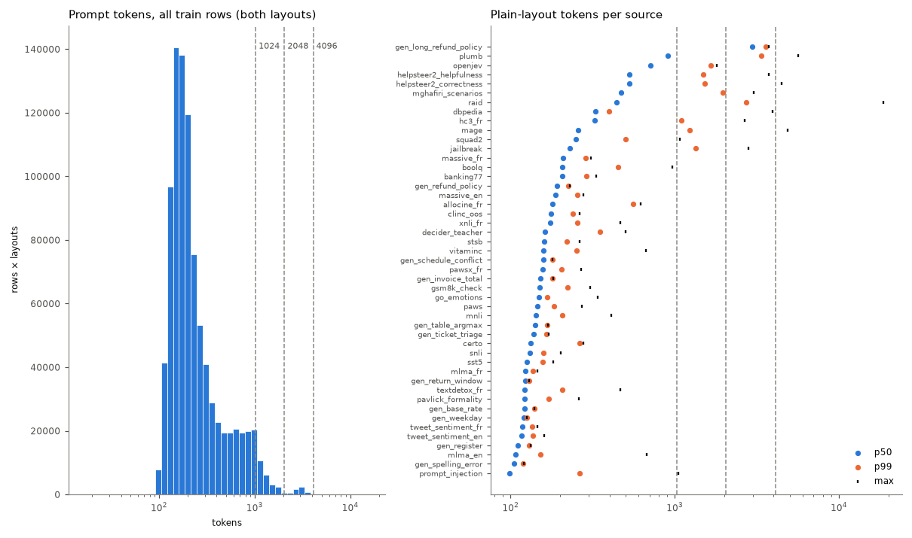
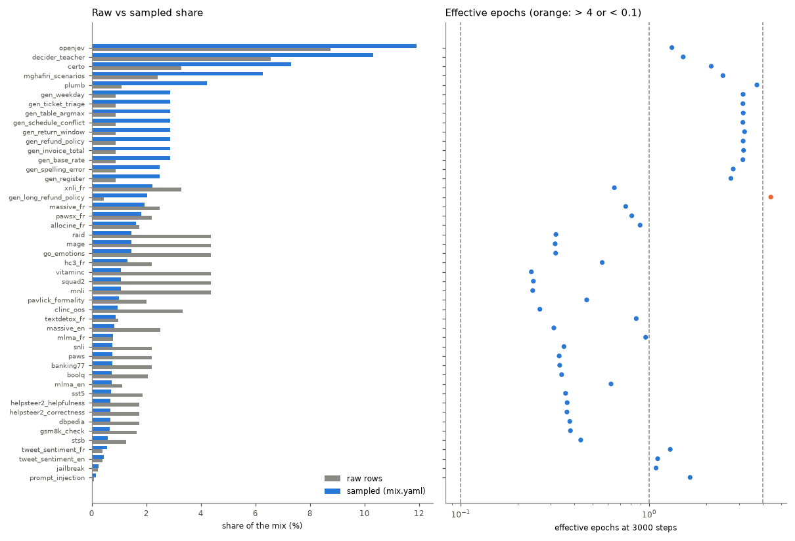
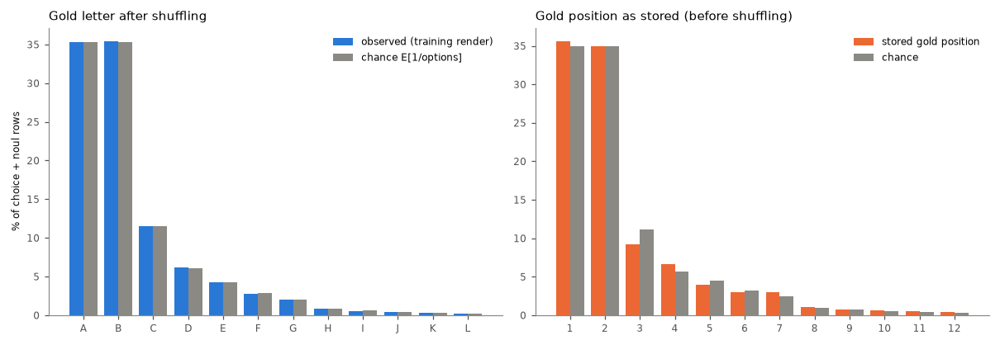

# Data quality: mix-v3

Generated by `scripts/data_report.py` in 255 s. Rows analysed: 456,718 of 456,718. Run assumed: 3000 steps × 65,536 tokens, microbatch 4096 tokens (accumulation 16), buckets [1024, 2048, 4096], 16 packing bins.

## Recommendations (ranked)

1. **Train overlaps test.** 2 train rows equal a test row on (state, instructions); 326 on the state alone; 330 test rows have a near-duplicate (J≥0.8) train state, 97 of them with the same instructions and gold label. Mostly certo: 56 near items, 8 equal states, 88 near states (of 300); openjev: 16 near items, 0 equal states, 60 near states (of 300); boolq: 0 near items, 100 equal states, 107 near states (of 300); banking77: 7 near items, 0 equal states, 9 near states (of 300). Drop them in the builder (cross-source key check, near check for every source). *Effect:* Removes optimistic bias of test metrics (0.9% of test rows are near-duplicate items). *Touches:* data rebuild (train file hashes → data identity).
2. **hc3_fr: one label for (almost) every row.** 100.0% of hc3_fr's hard-target rows have gold `noul:no`. The model learns a constant, and the source's held-out metrics are meaningless. Likely an adapter bug (label mapping): fix the adapter, or drop the source until it is fixed (its weight goes to its block). *Effect:* Removes a degenerate prior from its block (and from the French share). *Touches:* data rebuild (or weight 0: run config identity).
3. **Train overlaps validation.** 5 train rows equal a validation row on (state, instructions); 286 on the state alone; 312 validation rows have a near-duplicate (J≥0.8) train state, 105 of them with the same instructions and gold label. Mostly certo: 65 near items, 2 equal states, 86 near states (of 300); openjev: 16 near items, 0 equal states, 60 near states (of 300); boolq: 0 near items, 94 equal states, 101 near states (of 300); massive_en: 8 near items, 2 equal states, 14 near states (of 300). Drop them in the builder (cross-source key check, near check for every source). *Effect:* Removes optimistic bias of validation metrics (0.9% of validation rows are near-duplicate items). *Touches:* data rebuild (train file hashes → data identity).
4. **Train overlaps calibration.** 5 train rows equal a calibration row on (state, instructions); 238 on the state alone; 336 calibration rows have a near-duplicate (J≥0.8) train state, 106 of them with the same instructions and gold label. Mostly certo: 67 near items, 13 equal states, 109 near states (of 300); openjev: 17 near items, 0 equal states, 59 near states (of 299); boolq: 0 near items, 87 equal states, 97 near states (of 300); massive_en: 4 near items, 3 equal states, 9 near states (of 300). Drop them in the builder (cross-source key check, near check for every source). *Effect:* Removes optimistic bias of calibration metrics (0.9% of calibration rows are near-duplicate items). *Touches:* data rebuild (train file hashes → data identity).
5. **Template artefacts (python_repr).** 1761 rows (mghafiri_scenarios 1679, decider_teacher 79, helpsteer2_correctness 2, helpsteer2_helpfulness 1). Options (criteria) rendered as Python dict reprs such as `{'level': …, 'definition': …}` or `{'value': None}`: the adapter passes structured criteria through and parse_item str()s them. Map them to text (e.g. `level: definition`) in the adapter. *Effect:* Cleaner inputs; the model stops reading artefacts as features. *Touches:* data rebuild.
6. **Sources repeated > 4 epochs.** At 3000 steps: gen_long_refund_policy 4.4. Lower their weights or raise their caps / generate more rows (generators are cheap to regenerate). *Effect:* Less memorisation of small sources; the freed share goes to sources seen < 1 epoch. *Touches:* weights: run config identity only (mix.yaml); caps / generators: data rebuild.
7. **Exact duplicates.** 1785 rows are exact duplicates of another train row (0 across sources). Dedup. *Effect:* Their sources' effective epochs on the duplicated items fall; no new data. *Touches:* data rebuild.
8. **Template artefacts (nonstring_criterion).** 31 rows (mghafiri_scenarios 31). Noul criteria that are dicts: parse_item keeps them unconverted and the plain layout prints their repr. Same fix as python_repr. *Effect:* Cleaner inputs; the model stops reading artefacts as features. *Touches:* data rebuild.
9. **Long-bucket steps are under-filled.** T=2048: 21% of steps at 61% fill, T=4096: 22% of steps at 72% fill (overall fill 84%). A step is one bucket, and a long segment leaves a tail that only same-bucket segments may fill. Let short segments fill the tails of open 2048 / 4096 rows (first-fit across buckets ≥ their own), or shrink the long sources' share. *Effect:* Up to 16% more segments per step at the same cost. *Touches:* packer change: stream identity (pinned stream test) and slots_per_step.
10. **gen_long_refund_policy dominates the token budget.** gen_long_refund_policy is 2.0% of the sampled segments but 16.1% of the prompt tokens (p50 2969 tokens), at 4.4 epochs. *Effect:* Halving its weight frees ~half its token share for other sources; regenerating more rows lowers its epochs without changing its share. *Touches:* weight: run config identity; more rows: data rebuild.
11. **Rows longer than the largest bucket.** 75 rows exceed 4096 tokens in at least one layout; the packer drops them silently (54 draws in the simulation, 0.01%). Cap them in the builder or add a larger bucket. *Effect:* No silent drop; the sampled mix matches mix.yaml. *Touches:* data rebuild (or config identity for a new bucket).
12. **Template artefacts (html_entity).** 373 rows (mlma_en 96, tweet_sentiment_en 72, tweet_sentiment_fr 52, helpsteer2_helpfulness 38, helpsteer2_correctness 32). Unescape (`html.unescape`) in the adapters. *Effect:* Cleaner inputs; the model stops reading artefacts as features. *Touches:* data rebuild.
13. **Train overlaps jevbench.** 0 train rows equal a jevbench row on (state, instructions); 1 on the state alone; 1 jevbench rows have a near-duplicate (J≥0.8) train state, 0 of them with the same instructions and gold label. Mostly jevbench_easy: 0 near items, 1 equal states, 1 near states (of 48). Drop them in the builder (cross-source key check, near check for every source). *Effect:* Removes optimistic bias of jevbench metrics (0.0% of jevbench rows are near-duplicate items). *Touches:* data rebuild (train file hashes → data identity).
14. **Template artefacts (replacement_char).** 123 rows (vitaminc 63, helpsteer2_correctness 17, helpsteer2_helpfulness 17, raid 16, allocine_fr 5). Encoding damage in the source data (U+FFFD); drop or leave. *Effect:* Cleaner inputs; the model stops reading artefacts as features. *Touches:* data rebuild.
15. **Sources with many near-duplicate states.** Share of states that are near-duplicates (J≥0.8) of another state of the source: openjev 51%, gen_ticket_triage 45%. Expected for templated generators; for public data, near-dedup. *Effect:* Effective diversity is lower than the row count suggests. *Touches:* data rebuild.
16. **Template artefacts (none_literal).** 247 rows (decider_teacher 116, mghafiri_scenarios 48, plumb 37, mnli 31, helpsteer2_helpfulness 3). Literal None / nan in text: part are python reprs (see python_repr), part legitimate (`Witnesses: None`). *Effect:* Cleaner inputs; the model stops reading artefacts as features. *Touches:* data rebuild.
17. **Skewed yes/no base rates.** Yes-share outside 25–75%: hc3_fr 0%, mlma_fr 76%, mlma_en 83%, raid 97%. Fine if it mirrors the task; otherwise rebalance in the adapter (shuffling letters cannot fix a label prior). *Effect:* Better-calibrated yes/no on balanced evaluation sets. *Touches:* data rebuild.
18. **Template artefacts (html_tag).** 300 rows (openjev 150, mghafiri_scenarios 62, raid 49, helpsteer2_helpfulness 17, helpsteer2_correctness 16). Mostly legitimate (questions about HTML, code); a few scraped tables (dbpedia). Review before stripping. *Effect:* Cleaner inputs; the model stops reading artefacts as features. *Touches:* data rebuild.
19. **Template artefacts (placeholder).** 284 rows (raid 114, mage 48, helpsteer2_correctness 32, mghafiri_scenarios 32, helpsteer2_helpfulness 27). Mostly legitimate shell / template syntax (`{{.ID}}`, `${VAR}`); review, no blanket fix. *Effect:* Cleaner inputs; the model stops reading artefacts as features. *Touches:* data rebuild.

## Overview

|  | value |
|---|---|
| sources | 47 |
| train rows | 456,718 |
| prompt tokens (plain / json layout) | 132,361,260 / 148,676,137 |
| rows by language | fr 77,281, en 379,437 |
| sampled language share | fr 20.4%, en 79.6% |
| rows by type | noul 190,435, choice 210,071, score 56,212 |
| sampled type share | noul 43.8%, choice 45.3%, score 10.9% |
| options p50 / p90 / max | 3 / 7 / 26 |
| soft targets | 45,096 (9.9%), mean normalised entropy 0.40 |
| tokens plain p50 / p90 / p99 / max | 171 / 645 / 1497 / 18630 |
| tokens json p50 / p90 / p99 / max | 204 / 700 / 1598 / 18770 |
| bucket shares (both layouts) | 1024: 96.5%, 2048: 2.9%, 4096: 0.6%, >4096: 0.0% |
| rows over the largest bucket | 75 |
| segments per step (simulated) | 146.47 |
| packing fill (by bucket) | 83.7% (1024: 96.1%, 2048: 61.3%, 4096: 72.4%) |
| steps by bucket | 1024: 1726, 2048: 623, 4096: 651 |
| draws dropped as too long | 54 |

## Mix per source

Sampled share = mix.yaml weight; token share = sampled share × mean prompt length; epochs = segments of the source trained on in the simulated run / rows; seen = rows trained on at least once.

| source | block | rows | lang | types | opts p50 | raw | sampled | token share | epochs | seen |
|---|---|---|---|---|---|---|---|---|---|---|
| go_emotions | analysis | 20,000 | en | choice 20000 | 7 | 4.4% | 1.5% | 0.7% | 0.32 | 27.4% |
| hc3_fr | analysis | 10,000 | fr | noul 10000 | 2 | 2.2% | 1.3% | 1.3% | 0.56 | 43.2% |
| mage | analysis | 20,000 | en | noul 10977, choice 9023 | 2 | 4.4% | 1.5% | 1.5% | 0.32 | 27.1% |
| mlma_en | analysis | 5,040 | en | noul 5040 | 2 | 1.1% | 0.7% | 0.2% | 0.63 | 46.6% |
| mlma_fr | analysis | 3,589 | fr | noul 3589 | 2 | 0.8% | 0.8% | 0.3% | 0.96 | 61.7% |
| pavlick_formality | analysis | 9,215 | en | score 9215 | 5 | 2.0% | 1.0% | 0.4% | 0.47 | 36.9% |
| raid | analysis | 20,000 | en | noul 9978, choice 10022 | 4 | 4.4% | 1.5% | 2.0% | 0.32 | 27.5% |
| textdetox_fr | analysis | 4,450 | fr | noul 4450 | 2 | 1.0% | 0.9% | 0.3% | 0.85 | 58.0% |
| tweet_sentiment_en | analysis | 1,839 | en | choice 1839 | 3 | 0.4% | 0.4% | 0.2% | 1.11 | 66.5% |
| tweet_sentiment_fr | analysis | 1,828 | fr | choice 1828 | 3 | 0.4% | 0.6% | 0.2% | 1.29 | 72.3% |
| gen_base_rate | generators | 4,000 | fr/en | noul 4000 | 2 | 0.9% | 2.9% | 1.0% | 3.14 | 95.9% |
| gen_invoice_total | generators | 4,000 | en/fr | noul 4000 | 2 | 0.9% | 2.9% | 1.3% | 3.16 | 95.6% |
| gen_long_refund_policy | generators | 2,000 | en/fr | choice 2000 | 3 | 0.4% | 2.0% | 16.1% | 4.41 ⚠ | 98.5% |
| gen_refund_policy | generators | 4,000 | en/fr | choice 4000 | 3 | 0.9% | 2.9% | 1.6% | 3.15 | 95.7% |
| gen_return_window | generators | 4,000 | en/fr | noul 4000 | 2 | 0.9% | 2.9% | 1.0% | 3.20 | 95.9% |
| gen_schedule_conflict | generators | 4,000 | fr/en | noul 4000 | 2 | 0.9% | 2.9% | 1.3% | 3.14 | 95.7% |
| gen_table_argmax | generators | 4,000 | en/fr | choice 4000 | 4 | 0.9% | 2.9% | 1.2% | 3.15 | 95.4% |
| gen_ticket_triage | generators | 4,000 | en/fr | choice 4000 | 5 | 0.9% | 2.9% | 1.2% | 3.14 | 95.8% |
| gen_weekday | generators | 4,000 | en/fr | choice 4000 | 7 | 0.9% | 2.9% | 1.1% | 3.14 | 95.9% |
| certo | jev | 15,000 | en | noul 8480, choice 6488, score 32 | 2 | 3.3% | 7.3% | 2.9% | 2.13 | 87.9% |
| decider_teacher | jev | 30,000 | en | choice 17703, noul 8544, score 3753 | 4 | 6.6% | 10.3% | 5.1% | 1.51 | 77.8% |
| mghafiri_scenarios | jev | 11,042 | en | noul 4528, choice 4232, score 2282 | 3 | 2.4% | 6.3% | 10.0% | 2.46 | 91.6% |
| openjev | jev | 40,000 | en | choice 19687, noul 14069, score 6244 | 3 | 8.8% | 11.9% | 23.1% | 1.32 | 73.4% |
| plumb | jev | 5,014 | en | choice 2597, noul 2002, score 415 | 3 | 1.1% | 4.2% | 12.1% | 3.72 | 97.9% |
| allocine_fr | replay | 8,000 | fr | noul 8000 | 2 | 1.8% | 1.6% | 1.0% | 0.89 | 59.6% |
| banking77 | replay | 9,995 | en | choice 9995 | 8 | 2.2% | 0.8% | 0.5% | 0.34 | 28.7% |
| boolq | replay | 9,427 | en | noul 9427 | 2 | 2.1% | 0.7% | 0.5% | 0.34 | 29.2% |
| clinc_oos | replay | 15,245 | en | choice 15245 | 8 | 3.3% | 0.9% | 0.5% | 0.26 | 23.2% |
| dbpedia | replay | 8,000 | en | choice 8000 | 14 | 1.8% | 0.7% | 0.7% | 0.38 | 31.8% |
| gsm8k_check | replay | 7,473 | en | noul 7473 | 2 | 1.6% | 0.7% | 0.3% | 0.38 | 31.9% |
| helpsteer2_correctness | replay | 8,000 | en | score 8000 | 5 | 1.8% | 0.7% | 1.1% | 0.37 | 30.4% |
| helpsteer2_helpfulness | replay | 8,000 | en | score 8000 | 5 | 1.8% | 0.7% | 1.1% | 0.37 | 30.6% |
| jailbreak | replay | 985 | en | noul 985 | 2 | 0.2% | 0.2% | 0.2% | 1.09 | 65.6% |
| massive_en | replay | 11,502 | en | choice 11502 | 8 | 2.5% | 0.8% | 0.5% | 0.31 | 26.9% |
| massive_fr | replay | 11,410 | fr | choice 11410 | 8 | 2.5% | 1.9% | 1.2% | 0.75 | 52.8% |
| mnli | replay | 20,000 | en | noul 9992, choice 10008 | 3 | 4.4% | 1.1% | 0.5% | 0.24 | 21.5% |
| paws | replay | 10,000 | en | noul 10000 | 2 | 2.2% | 0.8% | 0.3% | 0.33 | 28.3% |
| pawsx_fr | replay | 10,000 | fr | noul 10000 | 2 | 2.2% | 1.8% | 0.8% | 0.81 | 55.2% |
| prompt_injection | replay | 393 | en | noul 393 | 2 | 0.1% | 0.2% | 0.0% | 1.65 | 80.7% |
| snli | replay | 10,000 | en | noul 4955, choice 5045 | 3 | 2.2% | 0.8% | 0.3% | 0.35 | 29.8% |
| squad2 | replay | 20,000 | en | noul 20000 | 2 | 4.4% | 1.1% | 0.8% | 0.24 | 21.5% |
| sst5 | replay | 8,538 | en | score 8538 | 5 | 1.9% | 0.7% | 0.3% | 0.36 | 30.1% |
| stsb | replay | 5,733 | en | score 5733 | 6 | 1.3% | 0.6% | 0.3% | 0.43 | 34.9% |
| vitaminc | replay | 20,000 | en | choice 20000 | 3 | 4.4% | 1.1% | 0.5% | 0.24 | 21.2% |
| xnli_fr | replay | 15,000 | fr | noul 7553, choice 7447 | 2 | 3.3% | 2.2% | 1.1% | 0.65 | 47.6% |
| gen_register | writing | 4,000 | fr/en | score 4000 | 3 | 0.9% | 2.5% | 0.8% | 2.71 | 92.8% |
| gen_spelling_error | writing | 4,000 | en/fr | noul 4000 | 2 | 0.9% | 2.5% | 0.8% | 2.79 | 93.9% |

## Labels

Gold letter under the training render (choice + noul), observed vs chance (E[1/shown]: with fewer options, A and B are more often right by construction): total variation 0.0013, A at 0.998× chance. As stored (before shuffling): total variation 0.0259, first label at 1.019× chance; this order is what a model would see with shuffling off. Score levels keep their order, so their letter is the level.

| letter | A | B | C | D | E | F | G | H | I | J |
|---|---|---|---|---|---|---|---|---|---|---|
| observed | 35.3% | 35.4% | 11.5% | 6.2% | 4.2% | 2.8% | 2.0% | 0.8% | 0.6% | 0.4% |
| chance | 35.3% | 35.3% | 11.5% | 6.1% | 4.2% | 2.8% | 2.0% | 0.8% | 0.6% | 0.4% |
| stored position | 35.6% | 34.9% | 9.2% | 6.6% | 4.0% | 3.0% | 3.0% | 1.1% | 0.8% | 0.6% |
| stored chance | 34.9% | 34.9% | 11.1% | 5.7% | 4.5% | 3.2% | 2.4% | 1.0% | 0.7% | 0.5% |

| source | letter TV | stored A/chance | majority gold | noul yes | score levels | soft | soft entropy |
|---|---|---|---|---|---|---|---|
| allocine_fr | 0.0026 | 0.991 | noul:yes 50.5% | 50.5% |  | 0.0% |  |
| banking77 | 0.01 | 0.929 | choice:other 12.1% |  |  | 0.0% |  |
| boolq | 0.0043 | 0.754 | noul:yes 62.3% | 62.3% |  | 0.0% |  |
| certo | 0.0044 | 0.98 | noul:yes 32.6% | 51.9% | 0.03 0.16 0.28 0.53 | 9.9% | 0.1149 |
| clinc_oos | 0.0071 | 0.904 | choice:other 13.1% |  |  | 0.0% |  |
| dbpedia | 0.0148 | 0.985 | choice:Athlete 7.6% |  |  | 0.0% |  |
| decider_teacher | 0.0034 | 1.153 | noul:no 16.0% | 43.7% | 0.05 0.17 0.62 0.16 0.00 | 0.0% |  |
| gen_base_rate | 0.001 | 1.151 |  | 42.5% |  | 100.0% | 0.6258 |
| gen_invoice_total | 0.014 | 0.995 | noul:yes 50.2% | 50.2% |  | 0.0% |  |
| gen_long_refund_policy | 0.0157 | 0.646 | choice:deny 54.7% |  |  | 0.0% |  |
| gen_refund_policy | 0.0063 | 0.676 | choice:deny 53.5% |  |  | 0.0% |  |
| gen_register |  |  | score:1 35.6% |  | 0.32 0.36 0.32 | 0.0% |  |
| gen_return_window | 0.0012 | 1.028 | noul:no 51.4% | 48.6% |  | 0.0% |  |
| gen_schedule_conflict | 0.0068 | 1.129 | noul:no 56.5% | 43.5% |  | 0.0% |  |
| gen_spelling_error | 0.0042 | 0.921 | noul:yes 53.9% | 53.9% |  | 0.0% |  |
| gen_table_argmax | 0.0086 | 1.004 | choice:Alice 13.1% |  |  | 0.0% |  |
| gen_ticket_triage | 0.0107 | 1.125 | choice:technical 23.1% |  |  | 0.0% |  |
| gen_weekday | 0.0212 | 1.029 | choice:Monday 10.5% |  |  | 0.0% |  |
| go_emotions | 0.0096 | 1.006 | choice:joy 58.6% |  |  | 70.1% | 0.411 |
| gsm8k_check | 0.0021 | 0.988 | noul:yes 50.6% | 50.6% |  | 0.0% |  |
| hc3_fr | 0.0027 | 2.0 | noul:no 100.0% | 0.0% |  | 0.0% |  |
| helpsteer2_correctness |  |  | score:4 47.8% |  | 0.07 0.10 0.10 0.25 0.48 | 0.0% |  |
| helpsteer2_helpfulness |  |  | score:4 41.1% |  | 0.08 0.10 0.12 0.29 0.41 | 0.0% |  |
| jailbreak | 0.0046 | 1.046 | noul:no 52.3% | 47.7% |  | 0.0% |  |
| mage | 0.0057 | 0.642 | noul:yes 40.2% | 73.3% |  | 0.0% |  |
| massive_en | 0.0101 | 0.921 | choice:other 11.9% |  |  | 0.0% |  |
| massive_fr | 0.0112 | 0.921 | choice:other 11.9% |  |  | 0.0% |  |
| mghafiri_scenarios | 0.0082 | 1.081 |  | 47.9% | 0.16 0.28 0.36 0.16 0.04 0.00 | 100.0% | 0.3387 |
| mlma_en | 0.0034 | 0.347 | noul:yes 86.9% | 82.7% |  | 12.6% | 0.8563 |
| mlma_fr | 0.0021 | 0.489 | noul:yes 78.0% | 75.5% |  | 7.3% | 0.9165 |
| mnli | 0.0073 | 1.19 | noul:no 32.8% | 34.3% |  | 0.0% |  |
| openjev | 0.0043 | 1.238 | noul:no 24.1% | 32.3% | 0.10 0.19 0.22 0.28 0.20 | 1.4% | 0.7851 |
| pavlick_formality |  |  | score:2 71.5% |  | 0.06 0.25 0.35 0.32 0.02 | 92.6% | 0.3307 |
| paws | 0.0082 | 1.118 | noul:no 55.9% | 44.1% |  | 0.0% |  |
| pawsx_fr | 0.0001 | 1.136 | noul:no 56.8% | 43.2% |  | 0.0% |  |
| plumb | 0.0045 | 1.06 | noul:no 21.7% | 46.2% | 0.25 0.31 0.22 0.17 0.05 | 10.7% | 0.7781 |
| prompt_injection | 0.0038 | 1.298 | noul:no 64.9% | 35.1% |  | 0.0% |  |
| raid | 0.003 | 0.297 | noul:yes 48.5% | 97.3% |  | 0.0% |  |
| snli | 0.0113 | 1.208 | noul:no 33.7% | 32.1% |  | 0.0% |  |
| squad2 | 0.0001 | 0.671 | noul:yes 66.5% | 66.5% |  | 0.0% |  |
| sst5 |  |  | score:3 27.2% |  | 0.13 0.26 0.19 0.27 0.15 | 0.0% |  |
| stsb |  |  | score:0 21.6% |  | 0.11 0.15 0.16 0.24 0.24 0.10 | 70.3% | 0.3276 |
| textdetox_fr | 0.0052 | 1.003 | noul:no 50.1% | 49.9% |  | 0.0% |  |
| tweet_sentiment_en | 0.0228 | 1.0 | choice:neutral 33.3% |  |  | 0.0% |  |
| tweet_sentiment_fr | 0.0053 | 0.996 | choice:neutral 33.4% |  |  | 0.0% |  |
| vitaminc | 0.0073 | 1.515 | choice:supported 50.5% |  |  | 0.0% |  |
| xnli_fr | 0.0041 | 1.188 | noul:no 33.2% | 34.0% |  | 0.0% |  |

## Duplication (train)

|  | rows |
|---|---|
| exact duplicates (beyond the first) | 1,785 (0 cross-source) |
| conflicting targets (same input + menu) | 0 in 0 groups (0 cross-source) |
| same state + instructions, other menu | 1,783 |
| rows whose state occurs in another row | 78,258 (7,990 cross-source) |
| distinct states | 404,394 |
| near-duplicate clusters / states in them | 11,057 / 38,139 |
| near-redundant states (beyond one per cluster) | 27,082 (404 in cross-source clusters) |

Cross-source shared states (distinct states): helpsteer2_correctness + helpsteer2_helpfulness: 3178; mage + squad2: 426; clinc_oos + massive_en: 107; massive_en + massive_fr: 36; clinc_oos + go_emotions: 20; mlma_en + mlma_fr: 12; go_emotions + pavlick_formality: 11; banking77 + clinc_oos: 7; go_emotions + massive_en: 5; boolq + squad2: 4

| source | rows | exact dup | conflicts | shared state | distinct states | near-redundant |
|---|---|---|---|---|---|---|
| allocine_fr | 8,000 | 5 | 0 | 10 | 7,995 | 0.0% |
| banking77 | 9,995 | 0 | 0 | 69 | 9,964 | 0.7% |
| boolq | 9,427 | 1 | 0 | 2415 | 7,896 | 2.0% |
| certo | 15,000 | 0 | 0 | 34 | 14,983 | 28.7% |
| clinc_oos | 15,245 | 0 | 0 | 198 | 15,210 | 1.4% |
| dbpedia | 8,000 | 0 | 0 | 0 | 8,000 | 0.0% |
| decider_teacher | 30,000 | 1170 | 0 | 20558 | 13,217 | 1.1% |
| gen_base_rate | 4,000 | 0 | 0 | 0 | 4,000 | 0.1% |
| gen_invoice_total | 4,000 | 0 | 0 | 0 | 4,000 | 0.0% |
| gen_long_refund_policy | 2,000 | 0 | 0 | 0 | 2,000 | 0.0% |
| gen_refund_policy | 4,000 | 0 | 0 | 0 | 4,000 | 2.5% |
| gen_register | 4,000 | 0 | 0 | 0 | 4,000 | 22.0% |
| gen_return_window | 4,000 | 0 | 0 | 0 | 4,000 | 4.7% |
| gen_schedule_conflict | 4,000 | 0 | 0 | 0 | 4,000 | 0.0% |
| gen_spelling_error | 4,000 | 0 | 0 | 0 | 4,000 | 16.6% |
| gen_table_argmax | 4,000 | 0 | 0 | 0 | 4,000 | 0.0% |
| gen_ticket_triage | 4,000 | 0 | 0 | 0 | 4,000 | 45.3% |
| gen_weekday | 4,000 | 0 | 0 | 0 | 4,000 | 0.0% |
| go_emotions | 20,000 | 69 | 0 | 134 | 19,910 | 0.0% |
| gsm8k_check | 7,473 | 0 | 0 | 0 | 7,473 | 0.0% |
| hc3_fr | 10,000 | 41 | 0 | 82 | 9,959 | 0.3% |
| helpsteer2_correctness | 8,000 | 1 | 0 | 3179 | 7,999 | 0.7% |
| helpsteer2_helpfulness | 8,000 | 2 | 0 | 3182 | 4,820 | 0.5% |
| jailbreak | 985 | 17 | 0 | 33 | 968 | 2.7% |
| mage | 20,000 | 0 | 0 | 428 | 19,999 | 0.4% |
| massive_en | 11,502 | 0 | 0 | 248 | 11,340 | 1.2% |
| massive_fr | 11,410 | 0 | 0 | 535 | 11,086 | 0.8% |
| mghafiri_scenarios | 11,042 | 0 | 0 | 11042 | 2,164 | 5.6% |
| mlma_en | 5,040 | 6 | 0 | 24 | 5,034 | 0.2% |
| mlma_fr | 3,589 | 12 | 0 | 34 | 3,565 | 1.2% |
| mnli | 20,000 | 0 | 0 | 0 | 20,000 | 0.4% |
| openjev | 40,000 | 33 | 0 | 16847 | 30,729 | 50.7% |
| pavlick_formality | 9,215 | 3 | 0 | 27 | 9,191 | 0.0% |
| paws | 10,000 | 7 | 0 | 16 | 9,993 | 5.6% |
| pawsx_fr | 10,000 | 142 | 0 | 271 | 9,856 | 6.0% |
| plumb | 5,014 | 7 | 0 | 4864 | 1,884 | 0.0% |
| prompt_injection | 393 | 0 | 0 | 2 | 391 | 2.6% |
| raid | 20,000 | 14 | 0 | 150 | 19,925 | 0.3% |
| snli | 10,000 | 0 | 0 | 0 | 10,000 | 0.2% |
| squad2 | 20,000 | 0 | 0 | 13460 | 11,717 | 0.0% |
| sst5 | 8,538 | 10 | 0 | 26 | 8,521 | 0.0% |
| stsb | 5,733 | 41 | 0 | 78 | 5,692 | 0.1% |
| textdetox_fr | 4,450 | 190 | 0 | 284 | 4,260 | 0.1% |
| tweet_sentiment_en | 1,839 | 0 | 0 | 0 | 1,839 | 0.1% |
| tweet_sentiment_fr | 1,828 | 9 | 0 | 18 | 1,819 | 1.9% |
| vitaminc | 20,000 | 5 | 0 | 10 | 19,995 | 3.6% |
| xnli_fr | 15,000 | 0 | 0 | 0 | 15,000 | 0.3% |

## Leakage (train vs held-out)

Held-out rows whose normalised (state, instructions) / state occurs in train, or whose state has a near-duplicate train state (est. Jaccard ≥ 0.8; *near item*: also the same instructions and gold label); and the train rows that would be dropped for the exact matches.

| split | rows | exact s+i | …same source | exact state | near state | near item | train rows s+i | train rows state |
|---|---|---|---|---|---|---|---|---|
| validation | 11,234 | 4 | 0 | 116 | 312 (2.8%) | 105 (0.9%) | 5 | 286 |
| calibration | 11,188 | 5 | 0 | 124 | 336 (3.0%) | 106 (0.9%) | 5 | 238 |
| heldout-select | 220 | 0 | 0 | 0 | 0 (0.0%) | 0 (0.0%) | 0 | 0 |
| test | 11,129 | 2 | 0 | 141 | 330 (3.0%) | 97 (0.9%) | 2 | 326 |
| jevbench | 231 | 0 | 0 | 1 | 1 (0.4%) | 0 (0.0%) | 0 | 1 |

Near pairs into validation (train source → held-out source): boolq → boolq: 100; certo → certo: 86; openjev → openjev: 60; massive_en → massive_en: 12; mage → squad2: 10; squad2 → mage: 7; massive_fr → massive_fr: 6; decider_teacher → decider_teacher: 6; tweet_sentiment_fr → tweet_sentiment_fr: 4; jailbreak → jailbreak: 3; banking77 → banking77: 2; clinc_oos → massive_en: 2; mlma_fr → mlma_fr: 2; mlma_en → mlma_en: 2; squad2 → boolq: 1

Near pairs into calibration (train source → held-out source): certo → certo: 109; boolq → boolq: 96; openjev → openjev: 59; mage → squad2: 11; squad2 → mage: 11; decider_teacher → decider_teacher: 9; massive_en → massive_en: 6; massive_fr → massive_fr: 6; mlma_fr → mlma_fr: 4; banking77 → banking77: 3; massive_en → clinc_oos: 3; clinc_oos → massive_en: 3; tweet_sentiment_fr → tweet_sentiment_fr: 3; jailbreak → jailbreak: 2; squad2 → boolq: 1

Near pairs into test (train source → held-out source): boolq → boolq: 107; certo → certo: 88; openjev → openjev: 60; mage → squad2: 15; squad2 → mage: 12; banking77 → banking77: 9; tweet_sentiment_fr → tweet_sentiment_fr: 6; massive_en → massive_en: 4; massive_fr → massive_fr: 4; mlma_fr → mlma_fr: 3; clinc_oos → clinc_oos: 2; decider_teacher → decider_teacher: 2; clinc_oos → go_emotions: 2; hc3_fr → hc3_fr: 2; clinc_oos → massive_en: 2

Near pairs into jevbench (train source → held-out source): massive_en → jevbench_easy: 1

## Length (prompt tokens, real template and tokenizer)

| source | plain p50 | p90 | p99 | max | json p50 | json max | buckets | > 4096 | state words p50 |
|---|---|---|---|---|---|---|---|---|---|
| allocine_fr | 179 | 387 | 558 | 622 | 202 | 649 | 1024: 100.0% | 0 | 69 |
| banking77 | 207 | 262 | 289 | 333 | 257 | 400 | 1024: 100.0% | 0 | 10 |
| boolq | 207 | 308 | 451 | 967 | 230 | 990 | 1024: 100.0% | 0 | 86 |
| certo | 132 | 148 | 263 | 276 | 155 | 315 | 1024: 100.0% | 0 | 15 |
| clinc_oos | 177 | 222 | 240 | 262 | 227 | 328 | 1024: 100.0% | 0 | 8 |
| dbpedia | 327 | 369 | 399 | 3945 | 400 | 4019 | 1024: 100.0%, 4096: 0.0% | 0 | 50 |
| decider_teacher | 162 | 240 | 349 | 504 | 189 | 539 | 1024: 100.0% | 0 | 32 |
| gen_base_rate | 122 | 135 | 139 | 140 | 145 | 163 | 1024: 100.0% | 0 | 24 |
| gen_invoice_total | 152 | 175 | 179 | 182 | 177 | 210 | 1024: 100.0% | 0 | 25 |
| gen_long_refund_policy | 2969 | 3340 | 3573 | 3754 | 2998 | 3784 | 4096: 100.0% | 0 | 2311 |
| gen_refund_policy | 192 | 220 | 225 | 229 | 221 | 259 | 1024: 100.0% | 0 | 53 |
| gen_register | 111 | 119 | 130 | 132 | 135 | 156 | 1024: 100.0% | 0 | 12 |
| gen_return_window | 123 | 128 | 129 | 129 | 146 | 152 | 1024: 100.0% | 0 | 20 |
| gen_schedule_conflict | 158 | 172 | 180 | 180 | 181 | 203 | 1024: 100.0% | 0 | 20 |
| gen_spelling_error | 105 | 115 | 119 | 121 | 128 | 144 | 1024: 100.0% | 0 | 20 |
| gen_table_argmax | 141 | 162 | 167 | 169 | 174 | 211 | 1024: 100.0% | 0 | 11 |
| gen_ticket_triage | 138 | 160 | 166 | 170 | 173 | 205 | 1024: 100.0% | 0 | 12 |
| gen_weekday | 121 | 125 | 126 | 126 | 164 | 177 | 1024: 100.0% | 0 | 14 |
| go_emotions | 148 | 160 | 167 | 339 | 196 | 387 | 1024: 100.0% | 0 | 13 |
| gsm8k_check | 151 | 184 | 223 | 305 | 175 | 329 | 1024: 100.0% | 0 | 48 |
| hc3_fr | 324 | 551 | 1100 | 2651 | 347 | 2675 | 1024: 98.7%, 2048: 1.2%, 4096: 0.1% | 0 | 166 |
| helpsteer2_correctness | 530 | 1000 | 1523 | 4494 | 568 | 4538 | 1024: 90.0%, 2048: 9.8%, 4096: 0.2%, >4096: 0.0% | 1 | 329 |
| helpsteer2_helpfulness | 530 | 990 | 1497 | 3722 | 568 | 3812 | 1024: 90.4%, 2048: 9.5%, 4096: 0.1% | 0 | 326 |
| jailbreak | 230 | 759 | 1338 | 2814 | 254 | 2881 | 1024: 95.2%, 2048: 4.4%, 4096: 0.4% | 0 | 103 |
| mage | 259 | 883 | 1227 | 4872 | 290 | 4902 | 1024: 93.7%, 2048: 6.1%, 4096: 0.1%, >4096: 0.0% | 3 | 118 |
| massive_en | 187 | 235 | 254 | 278 | 235 | 343 | 1024: 100.0% | 0 | 7 |
| massive_fr | 208 | 266 | 287 | 309 | 257 | 376 | 1024: 100.0% | 0 | 8 |
| mghafiri_scenarios | 470 | 1085 | 1967 | 3010 | 507 | 3108 | 1024: 85.8%, 2048: 13.3%, 4096: 0.9% | 0 | 169 |
| mlma_en | 107 | 123 | 152 | 673 | 130 | 702 | 1024: 100.0% | 0 | 15 |
| mlma_fr | 123 | 132 | 137 | 146 | 146 | 169 | 1024: 100.0% | 0 | 17 |
| mnli | 142 | 169 | 206 | 409 | 169 | 437 | 1024: 100.0% | 0 | 30 |
| openjev | 714 | 1104 | 1653 | 1810 | 808 | 1895 | 1024: 82.9%, 2048: 17.1% | 0 | 210 |
| pavlick_formality | 122 | 146 | 171 | 260 | 152 | 291 | 1024: 100.0% | 0 | 12 |
| paws | 145 | 166 | 183 | 272 | 170 | 297 | 1024: 100.0% | 0 | 39 |
| pawsx_fr | 157 | 183 | 204 | 270 | 180 | 293 | 1024: 100.0% | 0 | 44 |
| plumb | 909 | 1432 | 3376 | 5671 | 945 | 5822 | 1024: 59.6%, 2048: 33.2%, 4096: 7.1%, >4096: 0.1% | 9 | 472 |
| prompt_injection | 98 | 128 | 263 | 1054 | 121 | 1078 | 1024: 99.7%, 2048: 0.3% | 0 | 8 |
| raid | 443 | 625 | 2728 | 18630 | 479 | 18770 | 1024: 96.7%, 2048: 1.9%, 4096: 1.1%, >4096: 0.3% | 62 | 243 |
| snli | 131 | 144 | 158 | 202 | 159 | 233 | 1024: 100.0% | 0 | 21 |
| squad2 | 250 | 352 | 504 | 1076 | 274 | 1099 | 1024: 100.0%, 2048: 0.0% | 0 | 112 |
| sst5 | 126 | 143 | 157 | 182 | 157 | 213 | 1024: 100.0% | 0 | 17 |
| stsb | 160 | 189 | 220 | 262 | 194 | 296 | 1024: 100.0% | 0 | 19 |
| textdetox_fr | 122 | 148 | 207 | 466 | 146 | 489 | 1024: 100.0% | 0 | 17 |
| tweet_sentiment_en | 116 | 126 | 137 | 160 | 144 | 200 | 1024: 100.0% | 0 | 21 |
| tweet_sentiment_fr | 118 | 128 | 135 | 146 | 147 | 174 | 1024: 100.0% | 0 | 15 |
| vitaminc | 158 | 193 | 252 | 668 | 187 | 697 | 1024: 100.0% | 0 | 36 |
| xnli_fr | 174 | 211 | 256 | 465 | 203 | 497 | 1024: 100.0% | 0 | 34 |

## Quality flags

| flag | rows | top sources |
|---|---|---|
| artefact:control_char | 3 | raid 2, stsb 1 |
| artefact:html_entity | 373 | mlma_en 96, tweet_sentiment_en 72, tweet_sentiment_fr 52, helpsteer2_helpfulness 38, helpsteer2_correctness 32 |
| artefact:html_tag | 300 | openjev 150, mghafiri_scenarios 62, raid 49, helpsteer2_helpfulness 17, helpsteer2_correctness 16 |
| artefact:mojibake | 14 | helpsteer2_correctness 5, raid 3, helpsteer2_helpfulness 2, jailbreak 2, stsb 1 |
| artefact:none_literal | 247 | decider_teacher 116, mghafiri_scenarios 48, plumb 37, mnli 31, helpsteer2_helpfulness 3 |
| artefact:nonstring_criterion | 31 | mghafiri_scenarios 31 |
| artefact:placeholder | 284 | raid 114, mage 48, helpsteer2_correctness 32, mghafiri_scenarios 32, helpsteer2_helpfulness 27 |
| artefact:python_repr | 1761 | mghafiri_scenarios 1679, decider_teacher 79, helpsteer2_correctness 2, helpsteer2_helpfulness 1 |
| artefact:replacement_char | 123 | vitaminc 63, helpsteer2_correctness 17, helpsteer2_helpfulness 17, raid 16, allocine_fr 5 |
| lang_mismatch:state | 90 | raid 39, openjev 23, mage 11, textdetox_fr 6, mlma_en 5 |
| length:over_max_bucket | 20 | plumb 9, raid 7, mage 3, helpsteer2_correctness 1 |
| short_state | 1994 | massive_en 550, go_emotions 411, massive_fr 308, clinc_oos 198, decider_teacher 163 |

Extreme outliers: 2 rows above 4× their source's p99 length. Examples (≤ 20 per flag) are in report.json.

## Plots

