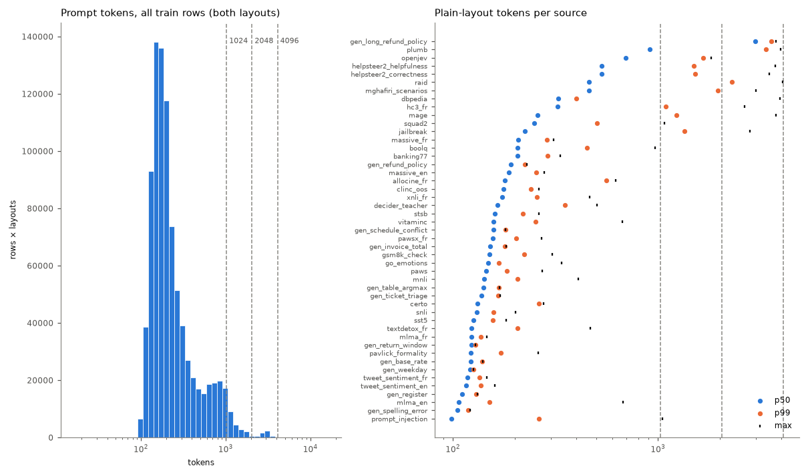
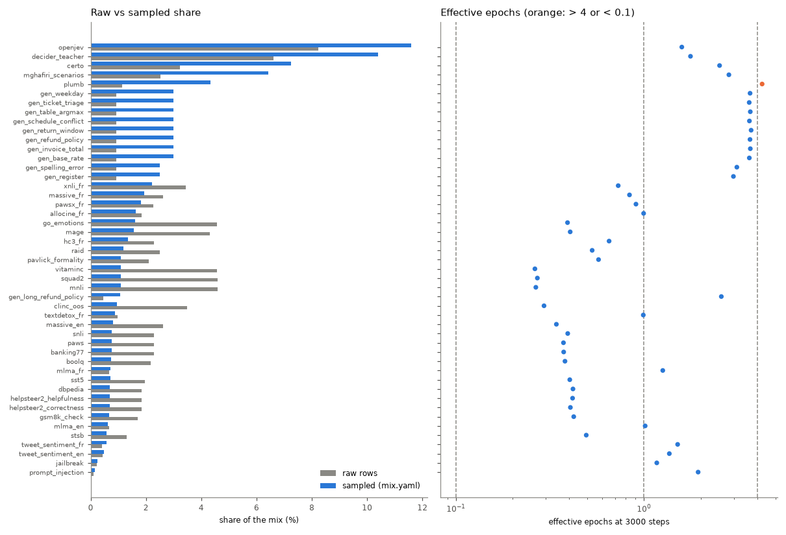
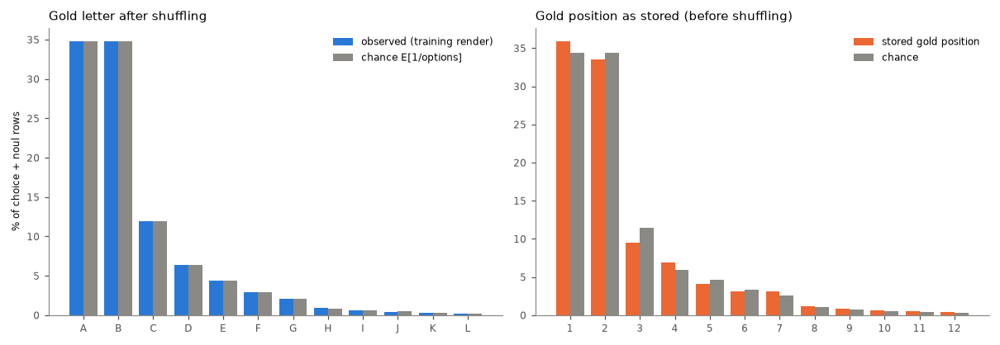

# Data quality: mix-v4r

Generated by `scripts/data_report.py` in 263 s. Rows analysed: 436,786 of 436,786. Run assumed: 3000 steps × 65,536 tokens, microbatch 4096 tokens (accumulation 16), buckets [1024, 2048, 4096], 16 packing bins.

## Recommendations (ranked)

1. **Sources repeated > 4 epochs.** At 3000 steps: plumb 4.2. Lower their weights or raise their caps / generate more rows (generators are cheap to regenerate). *Effect:* Less memorisation of small sources; the freed share goes to sources seen < 1 epoch. *Touches:* weights: run config identity only (mix.yaml); caps / generators: data rebuild.
2. **Template artefacts (python_repr).** 11 rows (decider_teacher 8, helpsteer2_correctness 2, helpsteer2_helpfulness 1). Options (criteria) rendered as Python dict reprs such as `{'level': …, 'definition': …}` or `{'value': None}`: the adapter passes structured criteria through and parse_item str()s them. Map them to text (e.g. `level: definition`) in the adapter. *Effect:* Cleaner inputs; the model stops reading artefacts as features. *Touches:* data rebuild.
3. **Long-bucket steps are under-filled.** T=2048: 21% of steps at 62% fill, T=4096: 14% of steps at 72% fill (overall fill 86%). A step is one bucket, and a long segment leaves a tail that only same-bucket segments may fill. Let short segments fill the tails of open 2048 / 4096 rows (first-fit across buckets ≥ their own), or shrink the long sources' share. *Effect:* Up to 14% more segments per step at the same cost. *Touches:* packer change: stream identity (pinned stream test) and slots_per_step.
4. **gen_long_refund_policy dominates the token budget.** gen_long_refund_policy is 1.1% of the sampled segments but 9.1% of the prompt tokens (p50 2969 tokens), at 2.6 epochs. *Effect:* Halving its weight frees ~half its token share for other sources; regenerating more rows lowers its epochs without changing its share. *Touches:* weight: run config identity; more rows: data rebuild.
5. **plumb dominates the token budget.** plumb is 4.3% of the sampled segments but 13.4% of the prompt tokens (p50 908 tokens), at 4.2 epochs. *Effect:* Halving its weight frees ~half its token share for other sources; regenerating more rows lowers its epochs without changing its share. *Touches:* weight: run config identity; more rows: data rebuild.
6. **Train overlaps jevbench.** 0 train rows equal a jevbench row on (state, instructions); 1 on the state alone; 1 jevbench rows have a near-duplicate (J≥0.8) train state, 0 of them with the same instructions and gold label. Mostly jevbench_easy: 0 near items, 1 equal states, 1 near states (of 48). Drop them in the builder (cross-source key check, near check for every source). *Effect:* Removes optimistic bias of jevbench metrics (0.0% of jevbench rows are near-duplicate items). *Touches:* data rebuild (train file hashes → data identity).
7. **Train overlaps test.** 0 train rows equal a test row on (state, instructions); 324 on the state alone; 184 test rows have a near-duplicate (J≥0.8) train state, 0 of them with the same instructions and gold label. Mostly boolq: 0 near items, 100 equal states, 107 near states (of 300); squad2: 0 near items, 13 equal states, 17 near states (of 300); openjev: 0 near items, 0 equal states, 28 near states (of 300); mage: 0 near items, 10 equal states, 12 near states (of 300). Drop them in the builder (cross-source key check, near check for every source). *Effect:* Removes optimistic bias of test metrics (0.0% of test rows are near-duplicate items). *Touches:* data rebuild (train file hashes → data identity).
8. **Train overlaps validation.** 0 train rows equal a validation row on (state, instructions); 258 on the state alone; 166 validation rows have a near-duplicate (J≥0.8) train state, 0 of them with the same instructions and gold label. Mostly boolq: 0 near items, 94 equal states, 101 near states (of 300); openjev: 0 near items, 0 equal states, 36 near states (of 300); squad2: 0 near items, 9 equal states, 10 near states (of 300); mage: 0 near items, 5 equal states, 7 near states (of 300). Drop them in the builder (cross-source key check, near check for every source). *Effect:* Removes optimistic bias of validation metrics (0.0% of validation rows are near-duplicate items). *Touches:* data rebuild (train file hashes → data identity).
9. **Train overlaps calibration.** 0 train rows equal a calibration row on (state, instructions); 230 on the state alone; 182 calibration rows have a near-duplicate (J≥0.8) train state, 0 of them with the same instructions and gold label. Mostly boolq: 0 near items, 87 equal states, 97 near states (of 300); openjev: 0 near items, 0 equal states, 36 near states (of 299); certo: 0 near items, 13 equal states, 14 near states (of 300); squad2: 0 near items, 10 equal states, 13 near states (of 300). Drop them in the builder (cross-source key check, near check for every source). *Effect:* Removes optimistic bias of calibration metrics (0.0% of calibration rows are near-duplicate items). *Touches:* data rebuild (train file hashes → data identity).
10. **Template artefacts (replacement_char).** 118 rows (vitaminc 63, helpsteer2_correctness 17, helpsteer2_helpfulness 17, raid 11, allocine_fr 5). Encoding damage in the source data (U+FFFD); drop or leave. *Effect:* Cleaner inputs; the model stops reading artefacts as features. *Touches:* data rebuild.
11. **Sources with many near-duplicate states.** Share of states that are near-duplicates (J≥0.8) of another state of the source: gen_ticket_triage 45%, openjev 45%. Expected for templated generators; for public data, near-dedup. *Effect:* Effective diversity is lower than the row count suggests. *Touches:* data rebuild.
12. **Template artefacts (none_literal).** 186 rows (decider_teacher 52, mghafiri_scenarios 52, plumb 37, mnli 31, helpsteer2_helpfulness 3). Literal None / nan in text: part are python reprs (see python_repr), part legitimate (`Witnesses: None`). *Effect:* Cleaner inputs; the model stops reading artefacts as features. *Touches:* data rebuild.
13. **Template artefacts (html_tag).** 281 rows (openjev 147, mghafiri_scenarios 62, raid 33, helpsteer2_helpfulness 17, helpsteer2_correctness 16). Mostly legitimate (questions about HTML, code); a few scraped tables (dbpedia). Review before stripping. *Effect:* Cleaner inputs; the model stops reading artefacts as features. *Touches:* data rebuild.
14. **Template artefacts (placeholder).** 221 rows (raid 55, mage 45, helpsteer2_correctness 32, mghafiri_scenarios 32, helpsteer2_helpfulness 27). Mostly legitimate shell / template syntax (`{{.ID}}`, `${VAR}`); review, no blanket fix. *Effect:* Cleaner inputs; the model stops reading artefacts as features. *Touches:* data rebuild.

## Overview

|  | value |
|---|---|
| sources | 47 |
| train rows | 436,786 |
| prompt tokens (plain / json layout) | 122,996,486 / 138,677,023 |
| rows by language | fr 76,175, en 360,611 |
| sampled language share | fr 20.4%, en 79.6% |
| rows by type | noul 173,749, choice 207,189, score 55,848 |
| sampled type share | noul 43.1%, choice 45.6%, score 11.2% |
| options p50 / p90 / max | 3 / 7 / 26 |
| soft targets | 44,609 (10.2%), mean normalised entropy 0.39 |
| tokens plain p50 / p90 / p99 / max | 170 / 627 / 1494 / 4051 |
| tokens json p50 / p90 / p99 / max | 202 / 678 / 1585 / 4095 |
| bucket shares (both layouts) | 1024: 96.9%, 2048: 2.5%, 4096: 0.6% |
| rows over the largest bucket | 0 |
| segments per step (simulated) | 163.16 |
| packing fill (by bucket) | 85.6% (1024: 96.1%, 2048: 61.9%, 4096: 72.1%) |
| steps by bucket | 1024: 1950, 2048: 618, 4096: 432 |
| draws dropped as too long | 0 |

## Mix per source

Sampled share = mix.yaml weight; token share = sampled share × mean prompt length; epochs = segments of the source trained on in the simulated run / rows; seen = rows trained on at least once.

| source | block | rows | lang | types | opts p50 | raw | sampled | token share | epochs | seen |
|---|---|---|---|---|---|---|---|---|---|---|
| go_emotions | analysis | 19,931 | en | choice 19931 | 7 | 4.6% | 1.6% | 0.8% | 0.39 | 32.5% |
| hc3_fr | analysis | 9,956 | fr | noul 9956 | 2 | 2.3% | 1.3% | 1.5% | 0.65 | 48.0% |
| mage | analysis | 18,803 | en | noul 9783, choice 9020 | 2 | 4.3% | 1.5% | 1.7% | 0.41 | 33.1% |
| mlma_en | analysis | 2,913 | en | noul 2913 | 2 | 0.7% | 0.6% | 0.2% | 1.01 | 63.1% |
| mlma_fr | analysis | 2,910 | fr | noul 2910 | 2 | 0.7% | 0.7% | 0.3% | 1.26 | 71.9% |
| pavlick_formality | analysis | 9,212 | en | score 9212 | 5 | 2.1% | 1.1% | 0.4% | 0.57 | 43.0% |
| raid | analysis | 10,891 | en | choice 9991, noul 900 | 6 | 2.5% | 1.2% | 1.8% | 0.53 | 41.4% |
| textdetox_fr | analysis | 4,260 | fr | noul 4260 | 2 | 1.0% | 0.9% | 0.4% | 0.99 | 63.0% |
| tweet_sentiment_en | analysis | 1,839 | en | choice 1839 | 3 | 0.4% | 0.5% | 0.2% | 1.36 | 73.8% |
| tweet_sentiment_fr | analysis | 1,804 | fr | choice 1804 | 3 | 0.4% | 0.6% | 0.2% | 1.51 | 77.7% |
| gen_base_rate | generators | 4,000 | fr/en | noul 4000 | 2 | 0.9% | 3.0% | 1.2% | 3.63 | 97.5% |
| gen_invoice_total | generators | 4,000 | en/fr | noul 4000 | 2 | 0.9% | 3.0% | 1.5% | 3.67 | 97.5% |
| gen_long_refund_policy | generators | 2,000 | en/fr | choice 2000 | 3 | 0.5% | 1.1% | 9.1% | 2.58 | 92.7% |
| gen_refund_policy | generators | 4,000 | en/fr | choice 4000 | 3 | 0.9% | 3.0% | 1.9% | 3.66 | 97.2% |
| gen_return_window | generators | 4,000 | en/fr | noul 4000 | 2 | 0.9% | 3.0% | 1.2% | 3.71 | 97.5% |
| gen_schedule_conflict | generators | 4,000 | fr/en | noul 4000 | 2 | 0.9% | 3.0% | 1.4% | 3.63 | 97.4% |
| gen_table_argmax | generators | 4,000 | en/fr | choice 4000 | 4 | 0.9% | 3.0% | 1.4% | 3.67 | 96.9% |
| gen_ticket_triage | generators | 4,000 | en/fr | choice 4000 | 5 | 0.9% | 3.0% | 1.4% | 3.62 | 97.2% |
| gen_weekday | generators | 4,000 | en/fr | choice 4000 | 7 | 0.9% | 3.0% | 1.3% | 3.66 | 97.7% |
| certo | jev | 14,061 | en | noul 7559, choice 6472, score 30 | 2 | 3.2% | 7.3% | 3.2% | 2.52 | 91.9% |
| decider_teacher | jev | 28,824 | en | choice 17015, noul 8056, score 3753 | 4 | 6.6% | 10.4% | 5.6% | 1.77 | 82.7% |
| mghafiri_scenarios | jev | 11,042 | en | noul 4528, choice 4232, score 2282 | 3 | 2.5% | 6.4% | 11.0% | 2.83 | 94.2% |
| openjev | jev | 35,969 | en | choice 17728, noul 12297, score 5944 | 3 | 8.2% | 11.6% | 23.7% | 1.59 | 79.5% |
| plumb | jev | 4,998 | en | choice 2592, noul 1991, score 415 | 3 | 1.1% | 4.3% | 13.4% | 4.24 ⚠ | 98.2% |
| allocine_fr | replay | 7,995 | fr | noul 7995 | 2 | 1.8% | 1.6% | 1.1% | 0.99 | 63.2% |
| banking77 | replay | 9,977 | en | choice 9977 | 8 | 2.3% | 0.8% | 0.5% | 0.37 | 31.4% |
| boolq | replay | 9,426 | en | noul 9426 | 2 | 2.2% | 0.7% | 0.5% | 0.38 | 31.9% |
| clinc_oos | replay | 15,233 | en | choice 15233 | 8 | 3.5% | 0.9% | 0.6% | 0.29 | 25.6% |
| dbpedia | replay | 8,000 | en | choice 8000 | 14 | 1.8% | 0.7% | 0.7% | 0.42 | 34.7% |
| gsm8k_check | replay | 7,473 | en | noul 7473 | 2 | 1.7% | 0.7% | 0.3% | 0.42 | 34.7% |
| helpsteer2_correctness | replay | 7,997 | en | score 7997 | 5 | 1.8% | 0.7% | 1.2% | 0.41 | 33.1% |
| helpsteer2_helpfulness | replay | 7,998 | en | score 7998 | 5 | 1.8% | 0.7% | 1.2% | 0.42 | 34.5% |
| jailbreak | replay | 958 | en | noul 958 | 2 | 0.2% | 0.2% | 0.2% | 1.17 | 69.1% |
| massive_en | replay | 11,472 | en | choice 11472 | 8 | 2.6% | 0.8% | 0.5% | 0.34 | 28.8% |
| massive_fr | replay | 11,388 | fr | choice 11388 | 8 | 2.6% | 1.9% | 1.3% | 0.84 | 56.7% |
| mnli | replay | 20,000 | en | noul 9992, choice 10008 | 3 | 4.6% | 1.1% | 0.5% | 0.27 | 23.4% |
| paws | replay | 9,993 | en | noul 9993 | 2 | 2.3% | 0.8% | 0.3% | 0.37 | 31.3% |
| pawsx_fr | replay | 9,858 | fr | noul 9858 | 2 | 2.3% | 1.8% | 0.9% | 0.91 | 59.6% |
| prompt_injection | replay | 393 | en | noul 393 | 2 | 0.1% | 0.2% | 0.1% | 1.94 | 85.8% |
| snli | replay | 10,000 | en | noul 4955, choice 5045 | 3 | 2.3% | 0.8% | 0.3% | 0.39 | 32.6% |
| squad2 | replay | 20,000 | en | noul 20000 | 2 | 4.6% | 1.1% | 0.9% | 0.27 | 23.7% |
| sst5 | replay | 8,528 | en | score 8528 | 5 | 2.0% | 0.7% | 0.3% | 0.40 | 33.3% |
| stsb | replay | 5,689 | en | score 5689 | 6 | 1.3% | 0.6% | 0.3% | 0.49 | 38.9% |
| vitaminc | replay | 19,995 | en | choice 19995 | 3 | 4.6% | 1.1% | 0.6% | 0.26 | 23.2% |
| xnli_fr | replay | 15,000 | fr | noul 7553, choice 7447 | 2 | 3.4% | 2.2% | 1.2% | 0.73 | 51.3% |
| gen_register | writing | 4,000 | fr/en | score 4000 | 3 | 0.9% | 2.5% | 0.9% | 2.99 | 94.5% |
| gen_spelling_error | writing | 4,000 | en/fr | noul 4000 | 2 | 0.9% | 2.5% | 0.8% | 3.12 | 95.7% |

## Labels

Gold letter under the training render (choice + noul), observed vs chance (E[1/shown]: with fewer options, A and B are more often right by construction): total variation 0.0006, A at 1.0× chance. As stored (before shuffling): total variation 0.036, first label at 1.045× chance; this order is what a model would see with shuffling off. Score levels keep their order, so their letter is the level.

| letter | A | B | C | D | E | F | G | H | I | J |
|---|---|---|---|---|---|---|---|---|---|---|
| observed | 34.8% | 34.8% | 11.9% | 6.3% | 4.4% | 2.9% | 2.1% | 0.9% | 0.6% | 0.4% |
| chance | 34.8% | 34.8% | 11.9% | 6.3% | 4.4% | 3.0% | 2.1% | 0.9% | 0.6% | 0.5% |
| stored position | 35.9% | 33.5% | 9.5% | 6.9% | 4.1% | 3.2% | 3.1% | 1.1% | 0.8% | 0.7% |
| stored chance | 34.4% | 34.4% | 11.5% | 5.9% | 4.6% | 3.3% | 2.5% | 1.0% | 0.7% | 0.6% |

| source | letter TV | stored A/chance | majority gold | noul yes | score levels | soft | soft entropy |
|---|---|---|---|---|---|---|---|
| allocine_fr | 0.0009 | 0.991 | noul:yes 50.5% | 50.5% |  | 0.0% |  |
| banking77 | 0.0112 | 0.929 | choice:other 12.1% |  |  | 0.0% |  |
| boolq | 0.0037 | 0.754 | noul:yes 62.3% | 62.3% |  | 0.0% |  |
| certo | 0.0094 | 0.99 | noul:yes 30.8% | 51.3% | 0.03 0.13 0.27 0.57 | 10.5% | 0.1149 |
| clinc_oos | 0.0132 | 0.904 | choice:other 13.1% |  |  | 0.0% |  |
| dbpedia | 0.019 | 0.985 | choice:Athlete 7.6% |  |  | 0.0% |  |
| decider_teacher | 0.0025 | 1.158 | noul:no 15.9% | 43.1% | 0.05 0.17 0.62 0.16 0.00 | 0.0% |  |
| gen_base_rate | 0.022 | 1.151 |  | 42.5% |  | 100.0% | 0.6258 |
| gen_invoice_total | 0.0025 | 0.995 | noul:yes 50.2% | 50.2% |  | 0.0% |  |
| gen_long_refund_policy | 0.0143 | 0.646 | choice:deny 54.7% |  |  | 0.0% |  |
| gen_refund_policy | 0.0077 | 0.676 | choice:deny 53.5% |  |  | 0.0% |  |
| gen_register |  |  | score:1 35.6% |  | 0.32 0.36 0.32 | 0.0% |  |
| gen_return_window | 0.0068 | 1.028 | noul:no 51.4% | 48.6% |  | 0.0% |  |
| gen_schedule_conflict | 0.0015 | 1.129 | noul:no 56.5% | 43.5% |  | 0.0% |  |
| gen_spelling_error | 0.0228 | 0.921 | noul:yes 53.9% | 53.9% |  | 0.0% |  |
| gen_table_argmax | 0.0155 | 1.004 | choice:Alice 13.1% |  |  | 0.0% |  |
| gen_ticket_triage | 0.0148 | 1.125 | choice:technical 23.1% |  |  | 0.0% |  |
| gen_weekday | 0.0159 | 1.029 | choice:Monday 10.5% |  |  | 0.0% |  |
| go_emotions | 0.0026 | 1.009 | choice:joy 58.1% |  |  | 70.4% | 0.411 |
| gsm8k_check | 0.0017 | 0.988 | noul:yes 50.6% | 50.6% |  | 0.0% |  |
| hc3_fr | 0.0017 | 1.377 | noul:no 68.8% | 31.2% |  | 0.0% |  |
| helpsteer2_correctness |  |  | score:4 47.8% |  | 0.07 0.10 0.10 0.25 0.48 | 0.0% |  |
| helpsteer2_helpfulness |  |  | score:4 41.0% |  | 0.08 0.10 0.12 0.29 0.41 | 0.0% |  |
| jailbreak | 0.0084 | 1.075 | noul:no 53.8% | 46.2% |  | 0.0% |  |
| mage | 0.0065 | 0.7 | noul:yes 36.4% | 70.0% |  | 0.0% |  |
| massive_en | 0.0103 | 0.92 | choice:other 11.9% |  |  | 0.0% |  |
| massive_fr | 0.0109 | 0.923 | choice:other 11.9% |  |  | 0.0% |  |
| mghafiri_scenarios | 0.01 | 1.081 |  | 47.9% | 0.16 0.28 0.36 0.16 0.04 0.00 | 100.0% | 0.3387 |
| mlma_en | 0.0046 | 0.6 | noul:yes 76.5% | 70.0% |  | 15.9% | 0.9029 |
| mlma_fr | 0.0096 | 0.6 | noul:yes 72.7% | 70.0% |  | 8.2% | 0.9245 |
| mnli | 0.0008 | 1.19 | noul:no 32.8% | 34.3% |  | 0.0% |  |
| openjev | 0.0058 | 1.249 | noul:no 24.1% | 30.0% | 0.10 0.17 0.23 0.30 0.21 | 0.8% | 0.7844 |
| pavlick_formality |  |  | score:2 71.5% |  | 0.06 0.25 0.35 0.32 0.02 | 92.6% | 0.3306 |
| paws | 0.0042 | 1.118 | noul:no 55.9% | 44.1% |  | 0.0% |  |
| pawsx_fr | 0.0019 | 1.133 | noul:no 56.7% | 43.3% |  | 0.0% |  |
| plumb | 0.0142 | 1.057 | noul:no 21.5% | 46.5% | 0.25 0.31 0.22 0.17 0.05 | 10.7% | 0.7781 |
| prompt_injection | 0.014 | 1.298 | noul:no 64.9% | 35.1% |  | 0.0% |  |
| raid | 0.0096 | 0.92 | choice:openai 25.8% | 70.0% |  | 0.0% |  |
| snli | 0.0053 | 1.208 | noul:no 33.7% | 32.1% |  | 0.0% |  |
| squad2 | 0.0059 | 0.671 | noul:yes 66.5% | 66.5% |  | 0.0% |  |
| sst5 |  |  | score:3 27.2% |  | 0.13 0.26 0.19 0.27 0.15 | 0.0% |  |
| stsb |  |  | score:0 21.6% |  | 0.11 0.15 0.16 0.24 0.24 0.10 | 70.2% | 0.3276 |
| textdetox_fr | 0.0047 | 1.007 | noul:no 50.3% | 49.6% |  | 0.0% |  |
| tweet_sentiment_en | 0.0163 | 1.0 | choice:neutral 33.3% |  |  | 0.0% |  |
| tweet_sentiment_fr | 0.0262 | 0.983 | choice:neutral 33.8% |  |  | 0.0% |  |
| vitaminc | 0.0009 | 1.514 | choice:supported 50.5% |  |  | 0.0% |  |
| xnli_fr | 0.0011 | 1.188 | noul:no 33.2% | 34.0% |  | 0.0% |  |

## Duplication (train)

|  | rows |
|---|---|
| exact duplicates (beyond the first) | 0 (0 cross-source) |
| conflicting targets (same input + menu) | 0 in 0 groups (0 cross-source) |
| same state + instructions, other menu | 1,398 |
| rows whose state occurs in another row | 74,810 (7,941 cross-source) |
| distinct states | 386,931 |
| near-duplicate clusters / states in them | 10,810 / 33,670 |
| near-redundant states (beyond one per cluster) | 22,860 (397 in cross-source clusters) |

Cross-source shared states (distinct states): helpsteer2_correctness + helpsteer2_helpfulness: 3178; mage + squad2: 426; clinc_oos + massive_en: 106; massive_en + massive_fr: 36; clinc_oos + go_emotions: 20; go_emotions + pavlick_formality: 11; banking77 + clinc_oos: 7; mlma_en + mlma_fr: 6; go_emotions + massive_en: 5; boolq + squad2: 4

| source | rows | exact dup | conflicts | shared state | distinct states | near-redundant |
|---|---|---|---|---|---|---|
| allocine_fr | 7,995 | 0 | 0 | 1 | 7,995 | 0.0% |
| banking77 | 9,977 | 0 | 0 | 67 | 9,947 | 0.7% |
| boolq | 9,426 | 0 | 0 | 2413 | 7,896 | 2.0% |
| certo | 14,061 | 0 | 0 | 32 | 14,045 | 25.4% |
| clinc_oos | 15,233 | 0 | 0 | 197 | 15,198 | 1.4% |
| dbpedia | 8,000 | 0 | 0 | 0 | 8,000 | 0.0% |
| decider_teacher | 28,824 | 0 | 0 | 19303 | 13,213 | 1.1% |
| gen_base_rate | 4,000 | 0 | 0 | 0 | 4,000 | 0.1% |
| gen_invoice_total | 4,000 | 0 | 0 | 0 | 4,000 | 0.0% |
| gen_long_refund_policy | 2,000 | 0 | 0 | 0 | 2,000 | 0.0% |
| gen_refund_policy | 4,000 | 0 | 0 | 0 | 4,000 | 2.5% |
| gen_register | 4,000 | 0 | 0 | 0 | 4,000 | 22.0% |
| gen_return_window | 4,000 | 0 | 0 | 0 | 4,000 | 4.7% |
| gen_schedule_conflict | 4,000 | 0 | 0 | 0 | 4,000 | 0.0% |
| gen_spelling_error | 4,000 | 0 | 0 | 0 | 4,000 | 16.6% |
| gen_table_argmax | 4,000 | 0 | 0 | 0 | 4,000 | 0.0% |
| gen_ticket_triage | 4,000 | 0 | 0 | 0 | 4,000 | 45.3% |
| gen_weekday | 4,000 | 0 | 0 | 0 | 4,000 | 0.0% |
| go_emotions | 19,931 | 0 | 0 | 39 | 19,910 | 0.0% |
| gsm8k_check | 7,473 | 0 | 0 | 0 | 7,473 | 0.0% |
| hc3_fr | 9,956 | 0 | 0 | 0 | 9,956 | 0.3% |
| helpsteer2_correctness | 7,997 | 0 | 0 | 3178 | 7,997 | 0.7% |
| helpsteer2_helpfulness | 7,998 | 0 | 0 | 3178 | 4,820 | 0.5% |
| jailbreak | 958 | 0 | 0 | 0 | 958 | 2.2% |
| mage | 18,803 | 0 | 0 | 428 | 18,802 | 0.4% |
| massive_en | 11,472 | 0 | 0 | 243 | 11,313 | 1.2% |
| massive_fr | 11,388 | 0 | 0 | 526 | 11,070 | 0.8% |
| mghafiri_scenarios | 11,042 | 0 | 0 | 11042 | 2,164 | 5.6% |
| mlma_en | 2,913 | 0 | 0 | 6 | 2,913 | 0.3% |
| mlma_fr | 2,910 | 0 | 0 | 6 | 2,904 | 1.0% |
| mnli | 20,000 | 0 | 0 | 0 | 20,000 | 0.4% |
| openjev | 35,969 | 0 | 0 | 15766 | 27,352 | 44.6% |
| pavlick_formality | 9,212 | 0 | 0 | 23 | 9,191 | 0.0% |
| paws | 9,993 | 0 | 0 | 2 | 9,993 | 5.6% |
| pawsx_fr | 9,858 | 0 | 0 | 2 | 9,856 | 6.0% |
| plumb | 4,998 | 0 | 0 | 4845 | 1,880 | 0.0% |
| prompt_injection | 393 | 0 | 0 | 2 | 391 | 2.6% |
| raid | 10,891 | 0 | 0 | 44 | 10,869 | 0.2% |
| snli | 10,000 | 0 | 0 | 0 | 10,000 | 0.2% |
| squad2 | 20,000 | 0 | 0 | 13460 | 11,717 | 0.0% |
| sst5 | 8,528 | 0 | 0 | 7 | 8,521 | 0.0% |
| stsb | 5,689 | 0 | 0 | 0 | 5,689 | 0.1% |
| textdetox_fr | 4,260 | 0 | 0 | 0 | 4,260 | 0.1% |
| tweet_sentiment_en | 1,839 | 0 | 0 | 0 | 1,839 | 0.1% |
| tweet_sentiment_fr | 1,804 | 0 | 0 | 0 | 1,804 | 1.5% |
| vitaminc | 19,995 | 0 | 0 | 0 | 19,995 | 3.6% |
| xnli_fr | 15,000 | 0 | 0 | 0 | 15,000 | 0.3% |

## Leakage (train vs held-out)

Held-out rows whose normalised (state, instructions) / state occurs in train, or whose state has a near-duplicate train state (est. Jaccard ≥ 0.8; *near item*: also the same instructions and gold label); and the train rows that would be dropped for the exact matches.

| split | rows | exact s+i | …same source | exact state | near state | near item | train rows s+i | train rows state |
|---|---|---|---|---|---|---|---|---|
| validation | 11,234 | 0 | 0 | 112 | 166 (1.5%) | 0 (0.0%) | 0 | 258 |
| calibration | 11,188 | 0 | 0 | 119 | 182 (1.6%) | 0 (0.0%) | 0 | 230 |
| heldout-select | 220 | 0 | 0 | 0 | 0 (0.0%) | 0 (0.0%) | 0 | 0 |
| test | 11,129 | 0 | 0 | 139 | 184 (1.7%) | 0 (0.0%) | 0 | 324 |
| jevbench | 231 | 0 | 0 | 1 | 1 (0.4%) | 0 (0.0%) | 0 | 1 |

Near pairs into validation (train source → held-out source): boolq → boolq: 100; openjev → openjev: 36; mage → squad2: 10; squad2 → mage: 7; decider_teacher → decider_teacher: 5; certo → certo: 3; squad2 → boolq: 1; jailbreak → helpsteer2_helpfulness: 1; prompt_injection → jailbreak: 1; clinc_oos → pavlick_formality: 1; clinc_oos → go_emotions: 1

Near pairs into calibration (train source → held-out source): boolq → boolq: 96; openjev → openjev: 36; certo → certo: 14; mage → squad2: 11; squad2 → mage: 11; decider_teacher → decider_teacher: 6; squad2 → boolq: 1; decider_teacher → clinc_oos: 1; squad2 → squad2: 1; boolq → squad2: 1; helpsteer2_correctness → jailbreak: 1; squad2 → jailbreak: 1; mage → mage: 1; clinc_oos → pavlick_formality: 1

Near pairs into test (train source → held-out source): boolq → boolq: 107; openjev → openjev: 28; mage → squad2: 15; squad2 → mage: 12; certo → certo: 9; decider_teacher → decider_teacher: 2; clinc_oos → go_emotions: 2; go_emotions → pavlick_formality: 2; boolq → squad2: 2; go_emotions → clinc_oos: 1; pavlick_formality → go_emotions: 1; squad2 → jailbreak: 1; mlma_fr → mlma_en: 1; massive_en → sst5: 1

Near pairs into jevbench (train source → held-out source): massive_en → jevbench_easy: 1

## Length (prompt tokens, real template and tokenizer)

| source | plain p50 | p90 | p99 | max | json p50 | json max | buckets | > 4096 | state words p50 |
|---|---|---|---|---|---|---|---|---|---|
| allocine_fr | 179 | 387 | 558 | 622 | 202 | 649 | 1024: 100.0% | 0 | 69 |
| banking77 | 207 | 262 | 289 | 333 | 257 | 400 | 1024: 100.0% | 0 | 10 |
| boolq | 207 | 308 | 451 | 967 | 230 | 990 | 1024: 100.0% | 0 | 86 |
| certo | 132 | 170 | 263 | 276 | 155 | 315 | 1024: 100.0% | 0 | 15 |
| clinc_oos | 177 | 222 | 240 | 262 | 227 | 328 | 1024: 100.0% | 0 | 8 |
| dbpedia | 327 | 369 | 399 | 3945 | 400 | 4019 | 1024: 100.0%, 4096: 0.0% | 0 | 50 |
| decider_teacher | 165 | 241 | 351 | 504 | 193 | 539 | 1024: 100.0% | 0 | 34 |
| gen_base_rate | 122 | 135 | 139 | 140 | 145 | 163 | 1024: 100.0% | 0 | 24 |
| gen_invoice_total | 152 | 175 | 179 | 182 | 177 | 210 | 1024: 100.0% | 0 | 25 |
| gen_long_refund_policy | 2969 | 3340 | 3573 | 3754 | 2998 | 3784 | 4096: 100.0% | 0 | 2311 |
| gen_refund_policy | 192 | 220 | 225 | 229 | 221 | 259 | 1024: 100.0% | 0 | 53 |
| gen_register | 111 | 119 | 130 | 132 | 135 | 156 | 1024: 100.0% | 0 | 12 |
| gen_return_window | 123 | 128 | 129 | 129 | 146 | 152 | 1024: 100.0% | 0 | 20 |
| gen_schedule_conflict | 158 | 172 | 180 | 180 | 181 | 203 | 1024: 100.0% | 0 | 20 |
| gen_spelling_error | 105 | 115 | 119 | 121 | 128 | 144 | 1024: 100.0% | 0 | 20 |
| gen_table_argmax | 141 | 162 | 167 | 169 | 174 | 211 | 1024: 100.0% | 0 | 11 |
| gen_ticket_triage | 138 | 160 | 166 | 170 | 173 | 205 | 1024: 100.0% | 0 | 12 |
| gen_weekday | 121 | 125 | 126 | 126 | 164 | 177 | 1024: 100.0% | 0 | 14 |
| go_emotions | 148 | 160 | 167 | 339 | 197 | 387 | 1024: 100.0% | 0 | 13 |
| gsm8k_check | 151 | 184 | 223 | 305 | 175 | 329 | 1024: 100.0% | 0 | 48 |
| hc3_fr | 324 | 551 | 1090 | 2651 | 347 | 2675 | 1024: 98.7%, 2048: 1.2%, 4096: 0.1% | 0 | 166 |
| helpsteer2_correctness | 530 | 1000 | 1521 | 3500 | 568 | 3542 | 1024: 90.0%, 2048: 9.8%, 4096: 0.2% | 0 | 329 |
| helpsteer2_helpfulness | 530 | 990 | 1497 | 3722 | 568 | 3812 | 1024: 90.4%, 2048: 9.5%, 4096: 0.1% | 0 | 326 |
| jailbreak | 224 | 745 | 1344 | 2814 | 246 | 2881 | 1024: 95.7%, 2048: 4.0%, 4096: 0.4% | 0 | 98 |
| mage | 259 | 864 | 1230 | 3753 | 290 | 3792 | 1024: 93.8%, 2048: 6.0%, 4096: 0.1% | 0 | 117 |
| massive_en | 187 | 235 | 254 | 278 | 235 | 343 | 1024: 100.0% | 0 | 7 |
| massive_fr | 208 | 266 | 287 | 309 | 258 | 376 | 1024: 100.0% | 0 | 8 |
| mghafiri_scenarios | 462 | 1076 | 1957 | 2994 | 500 | 3092 | 1024: 86.2%, 2048: 12.9%, 4096: 0.8% | 0 | 169 |
| mlma_en | 107 | 124 | 151 | 673 | 130 | 702 | 1024: 100.0% | 0 | 15 |
| mlma_fr | 123 | 132 | 137 | 146 | 147 | 169 | 1024: 100.0% | 0 | 17 |
| mnli | 142 | 169 | 206 | 409 | 169 | 437 | 1024: 100.0% | 0 | 30 |
| openjev | 695 | 1044 | 1660 | 1810 | 791 | 1895 | 1024: 86.9%, 2048: 13.1% | 0 | 207 |
| pavlick_formality | 122 | 146 | 171 | 260 | 152 | 291 | 1024: 100.0% | 0 | 12 |
| paws | 145 | 167 | 183 | 272 | 170 | 297 | 1024: 100.0% | 0 | 39 |
| pawsx_fr | 157 | 183 | 204 | 270 | 180 | 293 | 1024: 100.0% | 0 | 44 |
| plumb | 908 | 1422 | 3353 | 3972 | 944 | 4009 | 1024: 59.7%, 2048: 33.3%, 4096: 7.0% | 0 | 471 |
| prompt_injection | 98 | 128 | 263 | 1054 | 121 | 1078 | 1024: 99.7%, 2048: 0.3% | 0 | 8 |
| raid | 462 | 640 | 2297 | 4051 | 502 | 4095 | 1024: 97.1%, 2048: 1.7%, 4096: 1.2% | 0 | 241 |
| snli | 131 | 144 | 158 | 202 | 159 | 233 | 1024: 100.0% | 0 | 21 |
| squad2 | 250 | 352 | 504 | 1076 | 274 | 1099 | 1024: 100.0%, 2048: 0.0% | 0 | 112 |
| sst5 | 126 | 143 | 157 | 182 | 157 | 213 | 1024: 100.0% | 0 | 17 |
| stsb | 160 | 189 | 220 | 262 | 194 | 296 | 1024: 100.0% | 0 | 19 |
| textdetox_fr | 123 | 149 | 207 | 466 | 146 | 489 | 1024: 100.0% | 0 | 18 |
| tweet_sentiment_en | 116 | 126 | 137 | 160 | 144 | 200 | 1024: 100.0% | 0 | 20 |
| tweet_sentiment_fr | 118 | 128 | 135 | 146 | 147 | 174 | 1024: 100.0% | 0 | 15 |
| vitaminc | 158 | 193 | 252 | 668 | 187 | 697 | 1024: 100.0% | 0 | 36 |
| xnli_fr | 174 | 211 | 256 | 465 | 203 | 497 | 1024: 100.0% | 0 | 34 |

## Quality flags

| flag | rows | top sources |
|---|---|---|
| artefact:control_char | 2 | raid 1, stsb 1 |
| artefact:html_entity | 29 | jailbreak 12, raid 7, stsb 3, allocine_fr 2, boolq 1 |
| artefact:html_tag | 281 | openjev 147, mghafiri_scenarios 62, raid 33, helpsteer2_helpfulness 17, helpsteer2_correctness 16 |
| artefact:mojibake | 13 | helpsteer2_correctness 5, helpsteer2_helpfulness 2, jailbreak 2, raid 2, stsb 1 |
| artefact:none_literal | 186 | decider_teacher 52, mghafiri_scenarios 52, plumb 37, mnli 31, helpsteer2_helpfulness 3 |
| artefact:placeholder | 221 | raid 55, mage 45, helpsteer2_correctness 32, mghafiri_scenarios 32, helpsteer2_helpfulness 27 |
| artefact:python_repr | 11 | decider_teacher 8, helpsteer2_correctness 2, helpsteer2_helpfulness 1 |
| artefact:replacement_char | 118 | vitaminc 63, helpsteer2_correctness 17, helpsteer2_helpfulness 17, raid 11, allocine_fr 5 |
| lang_mismatch:state | 66 | openjev 23, raid 16, mage 10, textdetox_fr 6, mlma_en 5 |
| short_state | 1843 | massive_en 550, go_emotions 374, massive_fr 308, clinc_oos 198, sst5 139 |

Extreme outliers: 1 rows above 4× their source's p99 length. Examples (≤ 20 per flag) are in report.json.

## Plots

