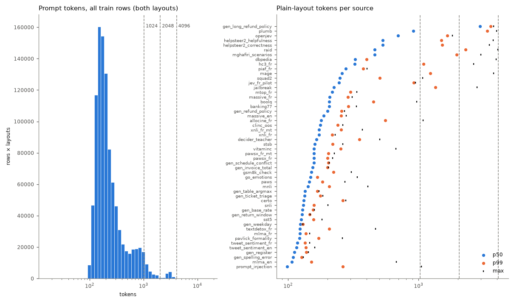
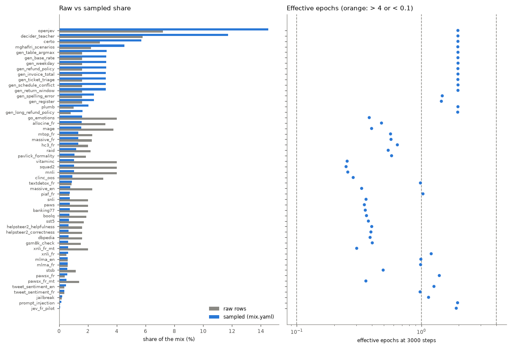
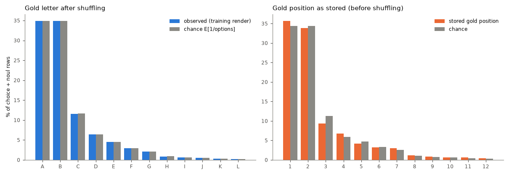

# Data quality: mix-v5

Generated by `scripts/data_report.py` in 1183 s. Rows analysed: 498,555 of 498,555. Run assumed: 3000 steps × 65,536 tokens, microbatch 4096 tokens (accumulation 16), buckets [1024, 2048, 4096], 16 packing bins.

## Recommendations (ranked)

1. **Template artefacts (python_repr).** 11 rows (decider_teacher 8, helpsteer2_correctness 2, helpsteer2_helpfulness 1). Options (criteria) rendered as Python dict reprs such as `{'level': …, 'definition': …}` or `{'value': None}`: the adapter passes structured criteria through and parse_item str()s them. Map them to text (e.g. `level: definition`) in the adapter. *Effect:* Cleaner inputs; the model stops reading artefacts as features. *Touches:* data rebuild.
2. **Long-bucket steps are under-filled.** T=2048: 17% of steps at 63% fill, T=4096: 18% of steps at 72% fill (overall fill 86%). A step is one bucket, and a long segment leaves a tail that only same-bucket segments may fill. Let short segments fill the tails of open 2048 / 4096 rows (first-fit across buckets ≥ their own), or shrink the long sources' share. *Effect:* Up to 14% more segments per step at the same cost. *Touches:* packer change: stream identity (pinned stream test) and slots_per_step.
3. **gen_long_refund_policy dominates the token budget.** gen_long_refund_policy is 1.6% of the sampled segments but 13.9% of the prompt tokens (p50 2962 tokens), at 2.0 epochs. *Effect:* Halving its weight frees ~half its token share for other sources; regenerating more rows lowers its epochs without changing its share. *Touches:* weight: run config identity; more rows: data rebuild.
4. **plumb dominates the token budget.** plumb is 2.0% of the sampled segments but 6.2% of the prompt tokens (p50 908 tokens), at 2.0 epochs. *Effect:* Halving its weight frees ~half its token share for other sources; regenerating more rows lowers its epochs without changing its share. *Touches:* weight: run config identity; more rows: data rebuild.
5. **Train overlaps jevbench.** 0 train rows equal a jevbench row on (state, instructions); 1 on the state alone; 1 jevbench rows have a near-duplicate (J≥0.8) train state, 0 of them with the same instructions and gold label. Mostly jevbench_easy: 0 near items, 1 equal states, 1 near states (of 48). Drop them in the builder (cross-source key check, near check for every source). *Effect:* Removes optimistic bias of jevbench metrics (0.0% of jevbench rows are near-duplicate items). *Touches:* data rebuild (train file hashes → data identity).
6. **Train overlaps test.** 0 train rows equal a test row on (state, instructions); 344 on the state alone; 197 test rows have a near-duplicate (J≥0.8) train state, 0 of them with the same instructions and gold label. Mostly boolq: 0 near items, 100 equal states, 107 near states (of 300); squad2: 0 near items, 13 equal states, 17 near states (of 300); openjev: 0 near items, 0 equal states, 28 near states (of 300); piaf_fr: 0 near items, 13 equal states, 13 near states (of 101). Drop them in the builder (cross-source key check, near check for every source). *Effect:* Removes optimistic bias of test metrics (0.0% of test rows are near-duplicate items). *Touches:* data rebuild (train file hashes → data identity).
7. **Train overlaps validation.** 0 train rows equal a validation row on (state, instructions); 299 on the state alone; 178 validation rows have a near-duplicate (J≥0.8) train state, 0 of them with the same instructions and gold label. Mostly boolq: 0 near items, 94 equal states, 101 near states (of 300); openjev: 0 near items, 0 equal states, 36 near states (of 300); piaf_fr: 0 near items, 12 equal states, 12 near states (of 86); squad2: 0 near items, 9 equal states, 10 near states (of 300). Drop them in the builder (cross-source key check, near check for every source). *Effect:* Removes optimistic bias of validation metrics (0.0% of validation rows are near-duplicate items). *Touches:* data rebuild (train file hashes → data identity).
8. **Train overlaps calibration.** 0 train rows equal a calibration row on (state, instructions); 271 on the state alone; 199 calibration rows have a near-duplicate (J≥0.8) train state, 0 of them with the same instructions and gold label. Mostly boolq: 0 near items, 87 equal states, 97 near states (of 300); openjev: 0 near items, 0 equal states, 36 near states (of 299); piaf_fr: 0 near items, 17 equal states, 17 near states (of 90); certo: 0 near items, 13 equal states, 14 near states (of 300). Drop them in the builder (cross-source key check, near check for every source). *Effect:* Removes optimistic bias of calibration metrics (0.0% of calibration rows are near-duplicate items). *Touches:* data rebuild (train file hashes → data identity).
9. **Template artefacts (replacement_char).** 124 rows (vitaminc 63, helpsteer2_correctness 17, helpsteer2_helpfulness 17, allocine_fr 11, raid 11). Encoding damage in the source data (U+FFFD); drop or leave. *Effect:* Cleaner inputs; the model stops reading artefacts as features. *Touches:* data rebuild.
10. **Sources with many near-duplicate states.** Share of states that are near-duplicates (J≥0.8) of another state of the source: gen_ticket_triage 58%, openjev 45%. Expected for templated generators; for public data, near-dedup. *Effect:* Effective diversity is lower than the row count suggests. *Touches:* data rebuild.
11. **Template artefacts (none_literal).** 186 rows (decider_teacher 52, mghafiri_scenarios 52, plumb 37, mnli 31, helpsteer2_helpfulness 3). Literal None / nan in text: part are python reprs (see python_repr), part legitimate (`Witnesses: None`). *Effect:* Cleaner inputs; the model stops reading artefacts as features. *Touches:* data rebuild.
12. **Template artefacts (html_tag).** 281 rows (openjev 147, mghafiri_scenarios 62, raid 33, helpsteer2_helpfulness 17, helpsteer2_correctness 16). Mostly legitimate (questions about HTML, code); a few scraped tables (dbpedia). Review before stripping. *Effect:* Cleaner inputs; the model stops reading artefacts as features. *Touches:* data rebuild.
13. **Template artefacts (placeholder).** 221 rows (raid 55, mage 45, helpsteer2_correctness 32, mghafiri_scenarios 32, helpsteer2_helpfulness 27). Mostly legitimate shell / template syntax (`{{.ID}}`, `${VAR}`); review, no blanket fix. *Effect:* Cleaner inputs; the model stops reading artefacts as features. *Touches:* data rebuild.

## Overview

|  | value |
|---|---|
| sources | 52 |
| train rows | 498,555 |
| prompt tokens (plain / json layout) | 139,280,458 / 156,905,659 |
| rows by language | fr 108,680, en 389,875 |
| sampled language share | fr 20.5%, en 79.5% |
| rows by type | noul 203,023, choice 235,661, score 59,871 |
| sampled type share | noul 42.1%, choice 46.8%, score 11.1% |
| options p50 / p90 / max | 3 / 7 / 26 |
| soft targets | 48,681 (9.8%), mean normalised entropy 0.41 |
| tokens plain p50 / p90 / p99 / max | 167 / 587 / 1714 / 4051 |
| tokens json p50 / p90 / p99 / max | 200 / 631 / 1855 / 4095 |
| bucket shares (both layouts) | 1024: 96.9%, 2048: 2.2%, 4096: 0.9% |
| rows over the largest bucket | 0 |
| segments per step (simulated) | 161.27 |
| packing fill (by bucket) | 86.0% (1024: 96.0%, 2048: 62.7%, 4096: 72.3%) |
| steps by bucket | 1024: 1937, 2048: 514, 4096: 549 |
| draws dropped as too long | 0 |

## Mix per source

Sampled share = mix.yaml weight; token share = sampled share × mean prompt length; epochs = segments of the source trained on in the simulated run / rows; seen = rows trained on at least once.

| source | block | rows | lang | types | opts p50 | raw | sampled | token share | epochs | seen |
|---|---|---|---|---|---|---|---|---|---|---|
| go_emotions | analysis | 19,931 | en | choice 19931 | 7 | 4.0% | 1.6% | 0.8% | 0.38 | 31.9% |
| hc3_fr | analysis | 9,956 | fr | noul 9956 | 2 | 2.0% | 1.3% | 1.4% | 0.64 | 47.6% |
| mage | analysis | 18,803 | en | noul 9783, choice 9020 | 2 | 3.8% | 1.5% | 1.7% | 0.40 | 32.5% |
| mlma_en | analysis | 2,913 | en | noul 2913 | 2 | 0.6% | 0.6% | 0.2% | 0.99 | 63.2% |
| mlma_fr | analysis | 2,910 | fr | noul 2910 | 2 | 0.6% | 0.6% | 0.2% | 0.99 | 62.5% |
| pavlick_formality | analysis | 9,212 | en | score 9212 | 5 | 1.8% | 1.1% | 0.4% | 0.58 | 44.2% |
| raid | analysis | 10,891 | en | choice 9991, noul 900 | 6 | 2.2% | 1.2% | 1.7% | 0.54 | 41.9% |
| textdetox_fr | analysis | 4,260 | fr | noul 4260 | 2 | 0.9% | 0.9% | 0.3% | 0.98 | 62.5% |
| tweet_sentiment_en | analysis | 1,839 | en | choice 1839 | 3 | 0.4% | 0.5% | 0.2% | 1.26 | 71.4% |
| tweet_sentiment_fr | analysis | 1,804 | fr | choice 1804 | 3 | 0.4% | 0.4% | 0.1% | 0.98 | 61.5% |
| gen_base_rate | generators | 8,000 | fr/en | noul 8000 | 2 | 1.6% | 3.3% | 1.3% | 1.97 | 86.4% |
| gen_invoice_total | generators | 8,000 | en/fr | noul 8000 | 2 | 1.6% | 3.3% | 1.6% | 1.97 | 85.7% |
| gen_long_refund_policy | generators | 4,000 | en/fr | choice 4000 | 3 | 0.8% | 1.6% | 13.9% | 1.96 | 85.7% |
| gen_refund_policy | generators | 8,000 | en/fr | choice 8000 | 3 | 1.6% | 3.3% | 2.1% | 1.96 | 85.6% |
| gen_return_window | generators | 8,000 | en/fr | noul 8000 | 2 | 1.6% | 3.2% | 1.3% | 1.97 | 85.8% |
| gen_schedule_conflict | generators | 8,000 | fr/en | noul 8000 | 2 | 1.6% | 3.2% | 1.6% | 1.97 | 85.8% |
| gen_table_argmax | generators | 8,000 | en/fr | choice 8000 | 5 | 1.6% | 3.3% | 1.4% | 1.97 | 86.0% |
| gen_ticket_triage | generators | 8,000 | en/fr | choice 8000 | 5 | 1.6% | 3.2% | 1.4% | 1.96 | 86.4% |
| gen_weekday | generators | 8,000 | en/fr | choice 8000 | 7 | 1.6% | 3.3% | 1.4% | 1.97 | 85.7% |
| certo | jev | 14,061 | en | noul 7559, choice 6472, score 30 | 2 | 2.8% | 5.7% | 2.5% | 1.97 | 86.0% |
| decider_teacher | jev | 28,824 | en | choice 17015, noul 8056, score 3753 | 4 | 5.8% | 11.7% | 6.3% | 1.97 | 86.0% |
| jev_fr_pilot | jev | 200 | fr | noul 87, choice 90, score 23 | 3 | 0.0% | 0.1% | 0.1% | 1.91 | 86.0% |
| mghafiri_scenarios | jev | 11,042 | en | noul 4528, choice 4232, score 2282 | 3 | 2.2% | 4.5% | 7.7% | 1.96 | 86.0% |
| openjev | jev | 35,969 | en | choice 17728, noul 12297, score 5944 | 3 | 7.2% | 14.5% | 29.2% | 1.96 | 86.1% |
| plumb | jev | 4,998 | en | choice 2592, noul 1991, score 415 | 3 | 1.0% | 2.0% | 6.2% | 1.97 | 86.6% |
| allocine_fr | replay | 15,985 | fr | noul 15985 | 2 | 3.2% | 1.6% | 1.0% | 0.48 | 38.0% |
| banking77 | replay | 9,977 | en | choice 9977 | 8 | 2.0% | 0.7% | 0.5% | 0.35 | 30.1% |
| boolq | replay | 9,426 | en | noul 9426 | 2 | 1.9% | 0.7% | 0.5% | 0.36 | 30.7% |
| clinc_oos | replay | 15,233 | en | choice 15233 | 8 | 3.1% | 0.9% | 0.5% | 0.28 | 24.8% |
| dbpedia | replay | 8,000 | en | choice 8000 | 14 | 1.6% | 0.7% | 0.7% | 0.39 | 32.2% |
| gsm8k_check | replay | 7,473 | en | noul 7473 | 2 | 1.5% | 0.6% | 0.3% | 0.40 | 33.6% |
| helpsteer2_correctness | replay | 7,997 | en | score 7997 | 5 | 1.6% | 0.7% | 1.2% | 0.39 | 32.3% |
| helpsteer2_helpfulness | replay | 7,998 | en | score 7998 | 5 | 1.6% | 0.7% | 1.2% | 0.40 | 32.9% |
| jailbreak | replay | 958 | en | noul 958 | 2 | 0.2% | 0.2% | 0.2% | 1.14 | 68.3% |
| massive_en | replay | 11,472 | en | choice 11472 | 8 | 2.3% | 0.8% | 0.5% | 0.33 | 28.2% |
| massive_fr | replay | 11,384 | fr | choice 11384 | 8 | 2.3% | 1.3% | 0.9% | 0.57 | 43.6% |
| mnli | replay | 20,000 | en | noul 9992, choice 10008 | 3 | 4.0% | 1.0% | 0.5% | 0.26 | 22.8% |
| mtop_fr | replay | 11,503 | fr | choice 11503 | 8 | 2.3% | 1.3% | 0.9% | 0.57 | 42.9% |
| paws | replay | 9,993 | en | noul 9993 | 2 | 2.0% | 0.7% | 0.3% | 0.35 | 29.3% |
| pawsx_fr | replay | 1,965 | fr | noul 1965 | 2 | 0.4% | 0.6% | 0.3% | 1.39 | 75.8% |
| pawsx_fr_mt | replay | 6,930 | fr | noul 6930 | 2 | 1.4% | 0.5% | 0.3% | 0.36 | 29.9% |
| piaf_fr | replay | 3,553 | fr | noul 3553 | 2 | 0.7% | 0.7% | 0.6% | 1.03 | 64.2% |
| prompt_injection | replay | 393 | en | noul 393 | 2 | 0.1% | 0.1% | 0.1% | 1.95 | 87.5% |
| snli | replay | 10,000 | en | noul 4955, choice 5045 | 3 | 2.0% | 0.7% | 0.3% | 0.36 | 30.4% |
| squad2 | replay | 20,000 | en | noul 20000 | 2 | 4.0% | 1.0% | 0.8% | 0.25 | 22.1% |
| sst5 | replay | 8,528 | en | score 8528 | 5 | 1.7% | 0.7% | 0.3% | 0.38 | 31.4% |
| stsb | replay | 5,689 | en | score 5689 | 6 | 1.1% | 0.6% | 0.3% | 0.49 | 39.6% |
| vitaminc | replay | 19,995 | en | choice 19995 | 3 | 4.0% | 1.0% | 0.5% | 0.25 | 22.4% |
| xnli_fr | replay | 2,490 | fr | noul 1234, choice 1256 | 3 | 0.5% | 0.6% | 0.3% | 1.20 | 69.8% |
| xnli_fr_mt | replay | 10,000 | fr | noul 4926, choice 5074 | 3 | 2.0% | 0.6% | 0.3% | 0.30 | 26.1% |
| gen_register | writing | 8,000 | fr/en | score 8000 | 3 | 1.6% | 2.4% | 0.9% | 1.45 | 76.0% |
| gen_spelling_error | writing | 8,000 | en/fr | noul 8000 | 2 | 1.6% | 2.4% | 0.8% | 1.47 | 77.2% |

## Labels

Gold letter under the training render (choice + noul), observed vs chance (E[1/shown]: with fewer options, A and B are more often right by construction): total variation 0.0012, A at 1.001× chance. As stored (before shuffling): total variation 0.0313, first label at 1.036× chance; this order is what a model would see with shuffling off. Score levels keep their order, so their letter is the level.

| letter | A | B | C | D | E | F | G | H | I | J |
|---|---|---|---|---|---|---|---|---|---|---|
| observed | 34.9% | 34.9% | 11.6% | 6.4% | 4.5% | 2.9% | 2.1% | 0.9% | 0.6% | 0.5% |
| chance | 34.8% | 34.8% | 11.7% | 6.4% | 4.5% | 2.9% | 2.1% | 0.9% | 0.6% | 0.5% |
| stored position | 35.7% | 33.9% | 9.3% | 6.8% | 4.2% | 3.2% | 3.0% | 1.1% | 0.8% | 0.7% |
| stored chance | 34.4% | 34.4% | 11.2% | 5.9% | 4.7% | 3.3% | 2.5% | 1.1% | 0.8% | 0.6% |

| source | letter TV | stored A/chance | majority gold | noul yes | score levels | soft | soft entropy |
|---|---|---|---|---|---|---|---|
| allocine_fr | 0.0021 | 0.996 | noul:yes 50.2% | 50.2% |  | 0.0% |  |
| banking77 | 0.0138 | 0.929 | choice:other 12.1% |  |  | 0.0% |  |
| boolq | 0.0063 | 0.754 | noul:yes 62.3% | 62.3% |  | 0.0% |  |
| certo | 0.0118 | 0.99 | noul:yes 30.8% | 51.3% | 0.03 0.13 0.27 0.57 | 10.5% | 0.1149 |
| clinc_oos | 0.0078 | 0.904 | choice:other 13.1% |  |  | 0.0% |  |
| dbpedia | 0.0135 | 0.985 | choice:Athlete 7.6% |  |  | 0.0% |  |
| decider_teacher | 0.003 | 1.158 | noul:no 15.9% | 43.1% | 0.05 0.17 0.62 0.16 0.00 | 0.0% |  |
| gen_base_rate | 0.0019 | 1.165 |  | 41.7% |  | 100.0% | 0.6194 |
| gen_invoice_total | 0.0026 | 0.989 | noul:yes 50.6% | 50.6% |  | 0.0% |  |
| gen_long_refund_policy | 0.0072 | 0.658 | choice:deny 54.4% |  |  | 0.0% |  |
| gen_refund_policy | 0.0153 | 0.686 | choice:deny 53.1% |  |  | 0.0% |  |
| gen_register |  |  | score:1 34.4% |  | 0.32 0.34 0.33 | 0.0% |  |
| gen_return_window | 0.007 | 1.015 | noul:no 50.8% | 49.2% |  | 0.0% |  |
| gen_schedule_conflict | 0.001 | 1.128 | noul:no 56.4% | 43.6% |  | 0.0% |  |
| gen_spelling_error | 0.0014 | 0.942 | noul:yes 52.9% | 52.9% |  | 0.0% |  |
| gen_table_argmax | 0.0057 | 1.019 | choice:Bruno 13.0% |  |  | 0.0% |  |
| gen_ticket_triage | 0.0105 | 1.079 | choice:technical 22.0% |  |  | 0.0% |  |
| gen_weekday | 0.0041 | 0.99 | choice:Tuesday 10.7% |  |  | 0.0% |  |
| go_emotions | 0.0037 | 1.009 | choice:joy 58.1% |  |  | 70.4% | 0.411 |
| gsm8k_check | 0.0018 | 0.988 | noul:yes 50.6% | 50.6% |  | 0.0% |  |
| hc3_fr | 0.0001 | 1.377 | noul:no 68.8% | 31.2% |  | 0.0% |  |
| helpsteer2_correctness |  |  | score:4 47.8% |  | 0.07 0.10 0.10 0.25 0.48 | 0.0% |  |
| helpsteer2_helpfulness |  |  | score:4 41.0% |  | 0.08 0.10 0.12 0.29 0.41 | 0.0% |  |
| jailbreak | 0.0042 | 1.075 | noul:no 53.8% | 46.2% |  | 0.0% |  |
| jev_fr_pilot | 0.0674 | 0.98 | noul:no 28.1% | 47.1% | 0.17 0.22 0.48 0.13 | 36.0% | 0.3192 |
| mage | 0.005 | 0.7 | noul:yes 36.4% | 70.0% |  | 0.0% |  |
| massive_en | 0.0074 | 0.92 | choice:other 11.9% |  |  | 0.0% |  |
| massive_fr | 0.0128 | 0.923 | choice:other 11.9% |  |  | 0.0% |  |
| mghafiri_scenarios | 0.0118 | 1.081 |  | 47.9% | 0.16 0.28 0.36 0.16 0.04 0.00 | 100.0% | 0.3387 |
| mlma_en | 0.0108 | 0.6 | noul:yes 76.5% | 70.0% |  | 15.9% | 0.9029 |
| mlma_fr | 0.0144 | 0.6 | noul:yes 72.7% | 70.0% |  | 8.2% | 0.9245 |
| mnli | 0.0023 | 1.19 | noul:no 32.8% | 34.3% |  | 0.0% |  |
| mtop_fr | 0.0145 | 0.924 | choice:other 11.9% |  |  | 0.0% |  |
| openjev | 0.0036 | 1.249 | noul:no 24.1% | 30.0% | 0.10 0.17 0.23 0.30 0.21 | 0.8% | 0.7844 |
| pavlick_formality |  |  | score:2 71.5% |  | 0.06 0.25 0.35 0.32 0.02 | 92.6% | 0.3306 |
| paws | 0.0063 | 1.118 | noul:no 55.9% | 44.1% |  | 0.0% |  |
| pawsx_fr | 0.0216 | 1.134 | noul:no 56.7% | 43.3% |  | 0.0% |  |
| pawsx_fr_mt | 0.0025 | 1.112 | noul:no 55.6% | 44.4% |  | 0.0% |  |
| piaf_fr | 0.001 | 0.998 | noul:yes 50.1% | 50.1% |  | 0.0% |  |
| plumb | 0.0197 | 1.057 | noul:no 21.5% | 46.5% | 0.25 0.31 0.22 0.17 0.05 | 10.7% | 0.7781 |
| prompt_injection | 0.0013 | 1.298 | noul:no 64.9% | 35.1% |  | 0.0% |  |
| raid | 0.007 | 0.92 | choice:openai 25.8% | 70.0% |  | 0.0% |  |
| snli | 0.0089 | 1.208 | noul:no 33.7% | 32.1% |  | 0.0% |  |
| squad2 | 0.0006 | 0.671 | noul:yes 66.5% | 66.5% |  | 0.0% |  |
| sst5 |  |  | score:3 27.2% |  | 0.13 0.26 0.19 0.27 0.15 | 0.0% |  |
| stsb |  |  | score:0 21.6% |  | 0.11 0.15 0.16 0.24 0.24 0.10 | 70.2% | 0.3276 |
| textdetox_fr | 0.0068 | 1.007 | noul:no 50.3% | 49.6% |  | 0.0% |  |
| tweet_sentiment_en | 0.0087 | 1.0 | choice:neutral 33.3% |  |  | 0.0% |  |
| tweet_sentiment_fr | 0.0081 | 0.983 | choice:neutral 33.8% |  |  | 0.0% |  |
| vitaminc | 0.0025 | 1.514 | choice:supported 50.5% |  |  | 0.0% |  |
| xnli_fr | 0.0066 | 1.222 | noul:no 33.5% | 32.3% |  | 0.0% |  |
| xnli_fr_mt | 0.0057 | 1.202 | noul:no 33.2% | 32.6% |  | 0.0% |  |

## Duplication (train)

|  | rows |
|---|---|
| exact duplicates (beyond the first) | 0 (0 cross-source) |
| conflicting targets (same input + menu) | 0 in 0 groups (0 cross-source) |
| same state + instructions, other menu | 1,683 |
| rows whose state occurs in another row | 85,578 (8,078 cross-source) |
| distinct states | 441,491 |
| near-duplicate clusters / states in them | 11,932 / 38,218 |
| near-redundant states (beyond one per cluster) | 26,286 (411 in cross-source clusters) |

Cross-source shared states (distinct states): helpsteer2_correctness + helpsteer2_helpfulness: 3178; mage + squad2: 426; clinc_oos + massive_en: 106; massive_fr + mtop_fr: 57; massive_en + massive_fr: 36; clinc_oos + go_emotions: 20; go_emotions + pavlick_formality: 11; banking77 + clinc_oos: 7; mlma_en + mlma_fr: 6; go_emotions + massive_en: 5

| source | rows | exact dup | conflicts | shared state | distinct states | near-redundant |
|---|---|---|---|---|---|---|
| allocine_fr | 15,985 | 0 | 0 | 1 | 15,985 | 0.0% |
| banking77 | 9,977 | 0 | 0 | 67 | 9,947 | 0.7% |
| boolq | 9,426 | 0 | 0 | 2413 | 7,896 | 2.0% |
| certo | 14,061 | 0 | 0 | 32 | 14,045 | 25.4% |
| clinc_oos | 15,233 | 0 | 0 | 197 | 15,198 | 1.4% |
| dbpedia | 8,000 | 0 | 0 | 0 | 8,000 | 0.0% |
| decider_teacher | 28,824 | 0 | 0 | 19303 | 13,213 | 1.1% |
| gen_base_rate | 8,000 | 0 | 0 | 0 | 8,000 | 0.1% |
| gen_invoice_total | 8,000 | 0 | 0 | 0 | 8,000 | 0.0% |
| gen_long_refund_policy | 4,000 | 0 | 0 | 0 | 4,000 | 0.0% |
| gen_refund_policy | 8,000 | 0 | 0 | 0 | 8,000 | 2.5% |
| gen_register | 8,000 | 0 | 0 | 4325 | 5,289 | 26.1% |
| gen_return_window | 8,000 | 0 | 0 | 0 | 8,000 | 5.1% |
| gen_schedule_conflict | 8,000 | 0 | 0 | 0 | 8,000 | 0.0% |
| gen_spelling_error | 8,000 | 0 | 0 | 0 | 8,000 | 17.5% |
| gen_table_argmax | 8,000 | 0 | 0 | 0 | 8,000 | 0.0% |
| gen_ticket_triage | 8,000 | 0 | 0 | 2620 | 6,501 | 57.5% |
| gen_weekday | 8,000 | 0 | 0 | 0 | 8,000 | 1.7% |
| go_emotions | 19,931 | 0 | 0 | 39 | 19,910 | 0.0% |
| gsm8k_check | 7,473 | 0 | 0 | 0 | 7,473 | 0.0% |
| hc3_fr | 9,956 | 0 | 0 | 0 | 9,956 | 0.3% |
| helpsteer2_correctness | 7,997 | 0 | 0 | 3178 | 7,997 | 0.7% |
| helpsteer2_helpfulness | 7,998 | 0 | 0 | 3178 | 4,820 | 0.5% |
| jailbreak | 958 | 0 | 0 | 0 | 958 | 2.2% |
| jev_fr_pilot | 200 | 0 | 0 | 1 | 200 | 3.0% |
| mage | 18,803 | 0 | 0 | 428 | 18,802 | 0.4% |
| massive_en | 11,472 | 0 | 0 | 243 | 11,313 | 1.2% |
| massive_fr | 11,384 | 0 | 0 | 574 | 11,066 | 0.8% |
| mghafiri_scenarios | 11,042 | 0 | 0 | 11042 | 2,164 | 5.6% |
| mlma_en | 2,913 | 0 | 0 | 6 | 2,913 | 0.3% |
| mlma_fr | 2,910 | 0 | 0 | 6 | 2,904 | 1.0% |
| mnli | 20,000 | 0 | 0 | 0 | 20,000 | 0.4% |
| mtop_fr | 11,503 | 0 | 0 | 237 | 11,347 | 0.2% |
| openjev | 35,969 | 0 | 0 | 15766 | 27,351 | 44.6% |
| pavlick_formality | 9,212 | 0 | 0 | 23 | 9,191 | 0.0% |
| paws | 9,993 | 0 | 0 | 1 | 9,993 | 5.6% |
| pawsx_fr | 1,965 | 0 | 0 | 0 | 1,965 | 2.1% |
| pawsx_fr_mt | 6,930 | 0 | 0 | 1 | 6,929 | 3.8% |
| piaf_fr | 3,553 | 0 | 0 | 3539 | 710 | 0.0% |
| plumb | 4,998 | 0 | 0 | 4845 | 1,880 | 0.0% |
| prompt_injection | 393 | 0 | 0 | 2 | 391 | 2.6% |
| raid | 10,891 | 0 | 0 | 44 | 10,869 | 0.2% |
| snli | 10,000 | 0 | 0 | 0 | 10,000 | 0.2% |
| squad2 | 20,000 | 0 | 0 | 13460 | 11,717 | 0.0% |
| sst5 | 8,528 | 0 | 0 | 7 | 8,521 | 0.0% |
| stsb | 5,689 | 0 | 0 | 0 | 5,689 | 0.1% |
| textdetox_fr | 4,260 | 0 | 0 | 0 | 4,260 | 0.1% |
| tweet_sentiment_en | 1,839 | 0 | 0 | 0 | 1,839 | 0.1% |
| tweet_sentiment_fr | 1,804 | 0 | 0 | 0 | 1,804 | 1.5% |
| vitaminc | 19,995 | 0 | 0 | 0 | 19,995 | 3.6% |
| xnli_fr | 2,490 | 0 | 0 | 0 | 2,490 | 3.5% |
| xnli_fr_mt | 10,000 | 0 | 0 | 0 | 10,000 | 0.1% |

## Leakage (train vs held-out)

Held-out rows whose normalised (state, instructions) / state occurs in train, or whose state has a near-duplicate train state (est. Jaccard ≥ 0.8; *near item*: also the same instructions and gold label); and the train rows that would be dropped for the exact matches.

| split | rows | exact s+i | …same source | exact state | near state | near item | train rows s+i | train rows state |
|---|---|---|---|---|---|---|---|---|
| validation | 11,640 | 0 | 0 | 124 | 178 (1.5%) | 0 (0.0%) | 0 | 299 |
| calibration | 11,620 | 0 | 0 | 136 | 199 (1.7%) | 0 (0.0%) | 0 | 271 |
| heldout-select | 220 | 0 | 0 | 0 | 0 (0.0%) | 0 (0.0%) | 0 | 0 |
| test | 11,584 | 0 | 0 | 152 | 197 (1.7%) | 0 (0.0%) | 0 | 344 |
| jevbench | 231 | 0 | 0 | 1 | 1 (0.4%) | 0 (0.0%) | 0 | 1 |

Near pairs into validation (train source → held-out source): boolq → boolq: 100; openjev → openjev: 36; piaf_fr → piaf_fr: 12; mage → squad2: 10; squad2 → mage: 7; decider_teacher → decider_teacher: 5; certo → certo: 3; squad2 → boolq: 1; jailbreak → helpsteer2_helpfulness: 1; prompt_injection → jailbreak: 1; clinc_oos → pavlick_formality: 1; clinc_oos → go_emotions: 1

Near pairs into calibration (train source → held-out source): boolq → boolq: 96; openjev → openjev: 36; piaf_fr → piaf_fr: 17; certo → certo: 14; mage → squad2: 11; squad2 → mage: 11; decider_teacher → decider_teacher: 6; squad2 → boolq: 1; decider_teacher → clinc_oos: 1; squad2 → squad2: 1; boolq → squad2: 1; helpsteer2_correctness → jailbreak: 1; squad2 → jailbreak: 1; mage → mage: 1; clinc_oos → pavlick_formality: 1

Near pairs into test (train source → held-out source): boolq → boolq: 107; openjev → openjev: 28; mage → squad2: 15; piaf_fr → piaf_fr: 13; squad2 → mage: 12; certo → certo: 9; decider_teacher → decider_teacher: 2; clinc_oos → go_emotions: 2; go_emotions → pavlick_formality: 2; boolq → squad2: 2; go_emotions → clinc_oos: 1; pavlick_formality → go_emotions: 1; squad2 → jailbreak: 1; mlma_fr → mlma_en: 1; massive_en → sst5: 1

Near pairs into jevbench (train source → held-out source): massive_en → jevbench_easy: 1

## Length (prompt tokens, real template and tokenizer)

| source | plain p50 | p90 | p99 | max | json p50 | json max | buckets | > 4096 | state words p50 |
|---|---|---|---|---|---|---|---|---|---|
| allocine_fr | 179 | 388 | 556 | 1082 | 203 | 1106 | 1024: 100.0%, 2048: 0.0% | 0 | 69 |
| banking77 | 207 | 262 | 289 | 333 | 257 | 400 | 1024: 100.0% | 0 | 10 |
| boolq | 207 | 308 | 451 | 967 | 230 | 990 | 1024: 100.0% | 0 | 86 |
| certo | 132 | 170 | 263 | 276 | 155 | 315 | 1024: 100.0% | 0 | 15 |
| clinc_oos | 177 | 222 | 240 | 262 | 227 | 328 | 1024: 100.0% | 0 | 8 |
| dbpedia | 327 | 369 | 399 | 3945 | 400 | 4019 | 1024: 100.0%, 4096: 0.0% | 0 | 50 |
| decider_teacher | 165 | 241 | 351 | 504 | 193 | 539 | 1024: 100.0% | 0 | 34 |
| gen_base_rate | 129 | 144 | 155 | 159 | 152 | 183 | 1024: 100.0% | 0 | 29 |
| gen_invoice_total | 154 | 177 | 200 | 204 | 178 | 232 | 1024: 100.0% | 0 | 27 |
| gen_long_refund_policy | 2962 | 3338 | 3577 | 3762 | 2992 | 3791 | 4096: 100.0% | 0 | 2313 |
| gen_refund_policy | 200 | 232 | 256 | 271 | 229 | 301 | 1024: 100.0% | 0 | 63 |
| gen_register | 112 | 123 | 138 | 143 | 136 | 168 | 1024: 100.0% | 0 | 12 |
| gen_return_window | 128 | 136 | 146 | 147 | 151 | 171 | 1024: 100.0% | 0 | 26 |
| gen_schedule_conflict | 158 | 186 | 204 | 207 | 181 | 230 | 1024: 100.0% | 0 | 28 |
| gen_spelling_error | 109 | 121 | 127 | 131 | 132 | 154 | 1024: 100.0% | 0 | 21 |
| gen_table_argmax | 135 | 157 | 168 | 173 | 170 | 216 | 1024: 100.0% | 0 | 13 |
| gen_ticket_triage | 134 | 161 | 176 | 184 | 169 | 220 | 1024: 100.0% | 0 | 12 |
| gen_weekday | 124 | 127 | 130 | 130 | 167 | 181 | 1024: 100.0% | 0 | 14 |
| go_emotions | 148 | 160 | 167 | 339 | 197 | 387 | 1024: 100.0% | 0 | 13 |
| gsm8k_check | 151 | 184 | 223 | 305 | 175 | 329 | 1024: 100.0% | 0 | 48 |
| hc3_fr | 324 | 551 | 1090 | 2651 | 347 | 2675 | 1024: 98.7%, 2048: 1.2%, 4096: 0.1% | 0 | 166 |
| helpsteer2_correctness | 530 | 1000 | 1521 | 3500 | 568 | 3542 | 1024: 90.0%, 2048: 9.8%, 4096: 0.2% | 0 | 329 |
| helpsteer2_helpfulness | 530 | 990 | 1497 | 3722 | 568 | 3812 | 1024: 90.4%, 2048: 9.5%, 4096: 0.1% | 0 | 326 |
| jailbreak | 224 | 745 | 1344 | 2814 | 246 | 2881 | 1024: 95.7%, 2048: 4.0%, 4096: 0.4% | 0 | 98 |
| jev_fr_pilot | 246 | 736 | 915 | 943 | 272 | 981 | 1024: 100.0% | 0 | 66 |
| mage | 259 | 864 | 1230 | 3753 | 290 | 3792 | 1024: 93.8%, 2048: 6.0%, 4096: 0.1% | 0 | 117 |
| massive_en | 187 | 235 | 254 | 278 | 235 | 343 | 1024: 100.0% | 0 | 7 |
| massive_fr | 208 | 266 | 287 | 309 | 258 | 376 | 1024: 100.0% | 0 | 8 |
| mghafiri_scenarios | 462 | 1076 | 1957 | 2994 | 500 | 3092 | 1024: 86.2%, 2048: 12.9%, 4096: 0.8% | 0 | 169 |
| mlma_en | 107 | 124 | 151 | 673 | 130 | 702 | 1024: 100.0% | 0 | 15 |
| mlma_fr | 123 | 132 | 137 | 146 | 147 | 169 | 1024: 100.0% | 0 | 17 |
| mnli | 142 | 169 | 206 | 409 | 169 | 437 | 1024: 100.0% | 0 | 30 |
| mtop_fr | 218 | 280 | 301 | 335 | 267 | 402 | 1024: 100.0% | 0 | 8 |
| openjev | 695 | 1044 | 1660 | 1810 | 791 | 1895 | 1024: 86.9%, 2048: 13.1% | 0 | 207 |
| pavlick_formality | 122 | 146 | 171 | 260 | 152 | 291 | 1024: 100.0% | 0 | 12 |
| paws | 145 | 167 | 183 | 272 | 170 | 297 | 1024: 100.0% | 0 | 39 |
| pawsx_fr | 158 | 184 | 201 | 219 | 181 | 242 | 1024: 100.0% | 0 | 43 |
| pawsx_fr_mt | 158 | 184 | 203 | 226 | 181 | 249 | 1024: 100.0% | 0 | 44 |
| piaf_fr | 276 | 337 | 377 | 403 | 300 | 426 | 1024: 100.0% | 0 | 114 |
| plumb | 908 | 1422 | 3353 | 3972 | 944 | 4009 | 1024: 59.7%, 2048: 33.3%, 4096: 7.0% | 0 | 471 |
| prompt_injection | 98 | 128 | 263 | 1054 | 121 | 1078 | 1024: 99.7%, 2048: 0.3% | 0 | 8 |
| raid | 462 | 640 | 2297 | 4051 | 502 | 4095 | 1024: 97.1%, 2048: 1.7%, 4096: 1.2% | 0 | 241 |
| snli | 131 | 144 | 158 | 202 | 159 | 233 | 1024: 100.0% | 0 | 21 |
| squad2 | 250 | 352 | 504 | 1076 | 274 | 1099 | 1024: 100.0%, 2048: 0.0% | 0 | 112 |
| sst5 | 126 | 143 | 157 | 182 | 157 | 213 | 1024: 100.0% | 0 | 17 |
| stsb | 160 | 189 | 220 | 262 | 194 | 296 | 1024: 100.0% | 0 | 19 |
| textdetox_fr | 123 | 149 | 207 | 466 | 146 | 489 | 1024: 100.0% | 0 | 18 |
| tweet_sentiment_en | 116 | 126 | 137 | 160 | 144 | 200 | 1024: 100.0% | 0 | 20 |
| tweet_sentiment_fr | 118 | 128 | 135 | 146 | 147 | 174 | 1024: 100.0% | 0 | 15 |
| vitaminc | 158 | 193 | 252 | 668 | 187 | 697 | 1024: 100.0% | 0 | 36 |
| xnli_fr | 173 | 199 | 218 | 229 | 201 | 260 | 1024: 100.0% | 0 | 34 |
| xnli_fr_mt | 173 | 210 | 254 | 371 | 201 | 402 | 1024: 100.0% | 0 | 34 |

## Quality flags

| flag | rows | top sources |
|---|---|---|
| artefact:control_char | 2 | raid 1, stsb 1 |
| artefact:html_entity | 31 | jailbreak 12, raid 7, allocine_fr 4, stsb 3, boolq 1 |
| artefact:html_tag | 281 | openjev 147, mghafiri_scenarios 62, raid 33, helpsteer2_helpfulness 17, helpsteer2_correctness 16 |
| artefact:mojibake | 15 | helpsteer2_correctness 5, helpsteer2_helpfulness 2, jailbreak 2, mtop_fr 2, raid 2 |
| artefact:none_literal | 186 | decider_teacher 52, mghafiri_scenarios 52, plumb 37, mnli 31, helpsteer2_helpfulness 3 |
| artefact:placeholder | 221 | raid 55, mage 45, helpsteer2_correctness 32, mghafiri_scenarios 32, helpsteer2_helpfulness 27 |
| artefact:python_repr | 11 | decider_teacher 8, helpsteer2_correctness 2, helpsteer2_helpfulness 1 |
| artefact:replacement_char | 124 | vitaminc 63, helpsteer2_correctness 17, helpsteer2_helpfulness 17, allocine_fr 11, raid 11 |
| lang_mismatch:state | 67 | openjev 23, raid 16, mage 10, textdetox_fr 6, mlma_en 5 |
| short_state | 1863 | massive_en 550, go_emotions 374, massive_fr 308, clinc_oos 198, sst5 139 |

Extreme outliers: 1 rows above 4× their source's p99 length. Examples (≤ 20 per flag) are in report.json.

## Plots

