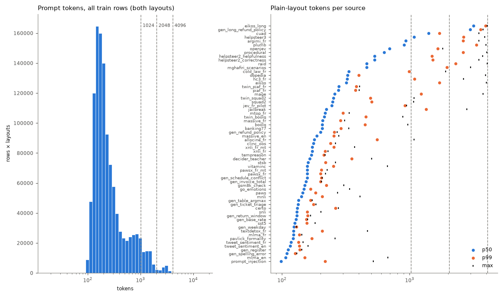
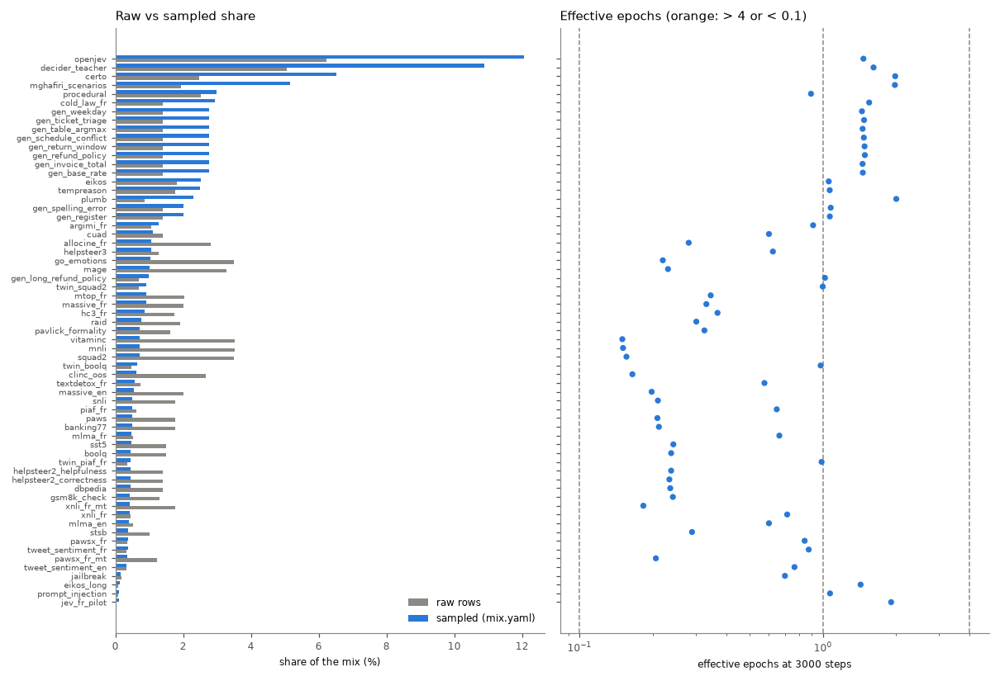
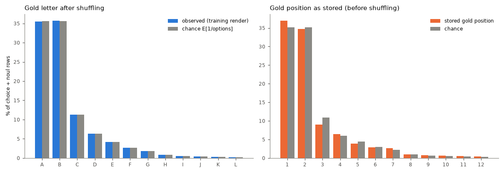

# Data quality: mix-v6

Generated by `scripts/data_report.py` in 1398 s. Rows analysed: 569,560 of 569,560. Run assumed: 3000 steps × 65,536 tokens, microbatch 4096 tokens (accumulation 16), buckets [1024, 2048, 4096], 16 packing bins.

## Recommendations (ranked)

1. **Template artefacts (python_repr).** 35 rows (eikos 14, eikos_long 9, decider_teacher 8, helpsteer2_correctness 2, helpsteer2_helpfulness 1). Options (criteria) rendered as Python dict reprs such as `{'level': …, 'definition': …}` or `{'value': None}`: the adapter passes structured criteria through and parse_item str()s them. Map them to text (e.g. `level: definition`) in the adapter. *Effect:* Cleaner inputs; the model stops reading artefacts as features. *Touches:* data rebuild.
2. **Long-bucket steps are under-filled.** T=2048: 26% of steps at 65% fill, T=4096: 14% of steps at 71% fill (overall fill 84%). A step is one bucket, and a long segment leaves a tail that only same-bucket segments may fill. Let short segments fill the tails of open 2048 / 4096 rows (first-fit across buckets ≥ their own), or shrink the long sources' share. *Effect:* Up to 16% more segments per step at the same cost. *Touches:* packer change: stream identity (pinned stream test) and slots_per_step.
3. **gen_long_refund_policy dominates the token budget.** gen_long_refund_policy is 1.0% of the sampled segments but 7.5% of the prompt tokens (p50 2970 tokens), at 1.0 epochs. *Effect:* Halving its weight frees ~half its token share for other sources; regenerating more rows lowers its epochs without changing its share. *Touches:* weight: run config identity; more rows: data rebuild.
4. **Train overlaps test.** 0 train rows equal a test row on (state, instructions); 0 on the state alone; 3 test rows have a near-duplicate (J≥0.8) train state, 0 of them with the same instructions and gold label. Mostly openjev: 0 near items, 0 equal states, 3 near states (of 300). Drop them in the builder (cross-source key check, near check for every source). *Effect:* Removes optimistic bias of test metrics (0.0% of test rows are near-duplicate items). *Touches:* data rebuild (train file hashes → data identity).
5. **Train overlaps calibration.** 0 train rows equal a calibration row on (state, instructions); 0 on the state alone; 1 calibration rows have a near-duplicate (J≥0.8) train state, 0 of them with the same instructions and gold label. Mostly openjev: 0 near items, 0 equal states, 1 near states (of 299). Drop them in the builder (cross-source key check, near check for every source). *Effect:* Removes optimistic bias of calibration metrics (0.0% of calibration rows are near-duplicate items). *Touches:* data rebuild (train file hashes → data identity).
6. **Template artefacts (replacement_char).** 126 rows (vitaminc 63, helpsteer2_correctness 17, helpsteer2_helpfulness 17, allocine_fr 11, raid 11). Encoding damage in the source data (U+FFFD); drop or leave. *Effect:* Cleaner inputs; the model stops reading artefacts as features. *Touches:* data rebuild.
7. **Sources with many near-duplicate states.** Share of states that are near-duplicates (J≥0.8) of another state of the source: gen_ticket_triage 58%, openjev 44%, cuad 38%. Expected for templated generators; for public data, near-dedup. *Effect:* Effective diversity is lower than the row count suggests. *Touches:* data rebuild.
8. **Template artefacts (none_literal).** 312 rows (eikos 69, decider_teacher 52, mghafiri_scenarios 52, eikos_long 44, plumb 37). Literal None / nan in text: part are python reprs (see python_repr), part legitimate (`Witnesses: None`). *Effect:* Cleaner inputs; the model stops reading artefacts as features. *Touches:* data rebuild.
9. **Template artefacts (html_tag).** 345 rows (openjev 148, mghafiri_scenarios 62, helpsteer3 36, raid 33, helpsteer2_helpfulness 17). Mostly legitimate (questions about HTML, code); a few scraped tables (dbpedia). Review before stripping. *Effect:* Cleaner inputs; the model stops reading artefacts as features. *Touches:* data rebuild.
10. **Template artefacts (placeholder).** 361 rows (helpsteer3 66, raid 55, eikos 46, mage 44, helpsteer2_correctness 32). Mostly legitimate shell / template syntax (`{{.ID}}`, `${VAR}`); review, no blanket fix. *Effect:* Cleaner inputs; the model stops reading artefacts as features. *Touches:* data rebuild.

## Overview

|  | value |
|---|---|
| sources | 63 |
| train rows | 569,560 |
| prompt tokens (plain / json layout) | 187,493,367 / 207,909,771 |
| rows by language | fr 127,522, en 442,038 |
| sampled language share | fr 20.9%, en 79.0% |
| rows by type | noul 243,886, choice 258,703, score 66,971 |
| sampled type share | noul 45.5%, choice 44.1%, score 10.4% |
| options p50 / p90 / max | 3 / 7 / 26 |
| soft targets | 54,165 (9.5%), mean normalised entropy 0.40 |
| tokens plain p50 / p90 / p99 / max | 179 / 752 / 2266 / 4051 |
| tokens json p50 / p90 / p99 / max | 210 / 820 / 2343 / 4095 |
| bucket shares (both layouts) | 1024: 94.0%, 2048: 4.8%, 4096: 1.1% |
| rows over the largest bucket | 0 |
| segments per step (simulated) | 142.42 |
| packing fill (by bucket) | 84.5% (1024: 96.0%, 2048: 65.4%, 4096: 70.5%) |
| steps by bucket | 1024: 1799, 2048: 785, 4096: 416 |
| draws dropped as too long | 0 |

## Mix per source

Sampled share = mix.yaml weight; token share = sampled share × mean prompt length; epochs = segments of the source trained on in the simulated run / rows; seen = rows trained on at least once.

| source | block | rows | lang | types | opts p50 | raw | sampled | token share | epochs | seen |
|---|---|---|---|---|---|---|---|---|---|---|
| go_emotions | analysis | 19,926 | en | choice 19926 | 7 | 3.5% | 1.0% | 0.5% | 0.22 | 19.9% |
| hc3_fr | analysis | 9,956 | fr | noul 9956 | 2 | 1.7% | 0.9% | 0.8% | 0.37 | 30.9% |
| mage | analysis | 18,712 | en | noul 9710, choice 9002 | 2 | 3.3% | 1.0% | 1.0% | 0.23 | 20.7% |
| mlma_en | analysis | 2,913 | en | noul 2913 | 2 | 0.5% | 0.4% | 0.1% | 0.60 | 45.0% |
| mlma_fr | analysis | 2,907 | fr | noul 2907 | 2 | 0.5% | 0.5% | 0.2% | 0.66 | 48.6% |
| pavlick_formality | analysis | 9,211 | en | score 9211 | 5 | 1.6% | 0.7% | 0.3% | 0.33 | 28.2% |
| raid | analysis | 10,891 | en | choice 9991, noul 900 | 6 | 1.9% | 0.8% | 1.0% | 0.30 | 25.9% |
| textdetox_fr | analysis | 4,260 | fr | noul 4260 | 2 | 0.7% | 0.6% | 0.2% | 0.57 | 44.7% |
| tweet_sentiment_en | analysis | 1,839 | en | choice 1839 | 3 | 0.3% | 0.3% | 0.1% | 0.76 | 54.2% |
| tweet_sentiment_fr | analysis | 1,804 | fr | choice 1804 | 3 | 0.3% | 0.4% | 0.1% | 0.87 | 57.9% |
| gen_base_rate | generators | 8,000 | fr/en | noul 8000 | 2 | 1.4% | 2.8% | 1.0% | 1.46 | 76.6% |
| gen_invoice_total | generators | 8,000 | en/fr | noul 8000 | 2 | 1.4% | 2.8% | 1.2% | 1.45 | 76.5% |
| gen_long_refund_policy | generators | 4,000 | en/fr | choice 4000 | 3 | 0.7% | 1.0% | 7.5% | 1.02 | 64.1% |
| gen_refund_policy | generators | 8,000 | en/fr | choice 8000 | 3 | 1.4% | 2.8% | 1.6% | 1.49 | 77.2% |
| gen_return_window | generators | 8,000 | en/fr | noul 8000 | 2 | 1.4% | 2.8% | 1.0% | 1.48 | 77.0% |
| gen_schedule_conflict | generators | 8,000 | fr/en | noul 8000 | 2 | 1.4% | 2.8% | 1.2% | 1.47 | 77.1% |
| gen_table_argmax | generators | 8,000 | en/fr | choice 8000 | 5 | 1.4% | 2.8% | 1.1% | 1.46 | 76.0% |
| gen_ticket_triage | generators | 8,000 | en/fr | choice 8000 | 5 | 1.4% | 2.8% | 1.1% | 1.48 | 77.3% |
| gen_weekday | generators | 8,000 | en/fr | choice 8000 | 7 | 1.4% | 2.8% | 1.0% | 1.45 | 76.7% |
| certo | jev | 14,037 | en | noul 7559, choice 6448, score 30 | 2 | 2.5% | 6.5% | 2.5% | 1.98 | 86.3% |
| decider_teacher | jev | 28,810 | en | choice 17001, noul 8056, score 3753 | 4 | 5.1% | 10.9% | 5.2% | 1.61 | 80.1% |
| jev_fr_pilot | jev | 200 | fr | noul 87, choice 90, score 23 | 3 | 0.0% | 0.1% | 0.1% | 1.91 | 82.5% |
| mghafiri_scenarios | jev | 11,004 | en | noul 4513, choice 4215, score 2276 | 3 | 1.9% | 5.2% | 7.8% | 1.97 | 86.4% |
| openjev | jev | 35,399 | en | choice 17697, noul 11933, score 5769 | 3 | 6.2% | 12.1% | 21.7% | 1.47 | 77.1% |
| plumb | jev | 4,920 | en | noul 1953, score 415, choice 2552 | 3 | 0.9% | 2.3% | 6.2% | 2.00 | 86.7% |
| allocine_fr | replay | 15,985 | fr | noul 15985 | 2 | 2.8% | 1.1% | 0.6% | 0.28 | 24.4% |
| banking77 | replay | 9,977 | en | choice 9977 | 8 | 1.8% | 0.5% | 0.3% | 0.21 | 19.0% |
| boolq | replay | 8,478 | en | noul 8478 | 2 | 1.5% | 0.5% | 0.3% | 0.24 | 21.2% |
| clinc_oos | replay | 15,224 | en | choice 15224 | 8 | 2.7% | 0.6% | 0.3% | 0.17 | 15.3% |
| dbpedia | replay | 8,000 | en | choice 8000 | 14 | 1.4% | 0.4% | 0.4% | 0.24 | 21.0% |
| gsm8k_check | replay | 7,447 | en | noul 7447 | 2 | 1.3% | 0.4% | 0.2% | 0.24 | 21.6% |
| helpsteer2_correctness | replay | 7,995 | en | score 7995 | 5 | 1.4% | 0.4% | 0.7% | 0.23 | 20.9% |
| helpsteer2_helpfulness | replay | 7,997 | en | score 7997 | 5 | 1.4% | 0.4% | 0.7% | 0.24 | 21.1% |
| jailbreak | replay | 956 | en | noul 956 | 2 | 0.2% | 0.2% | 0.1% | 0.70 | 50.5% |
| massive_en | replay | 11,469 | en | choice 11469 | 8 | 2.0% | 0.5% | 0.3% | 0.20 | 18.1% |
| massive_fr | replay | 11,384 | fr | choice 11384 | 8 | 2.0% | 0.9% | 0.5% | 0.33 | 28.2% |
| mnli | replay | 20,000 | en | noul 9992, choice 10008 | 3 | 3.5% | 0.7% | 0.3% | 0.15 | 14.0% |
| mtop_fr | replay | 11,503 | fr | choice 11503 | 8 | 2.0% | 0.9% | 0.6% | 0.35 | 29.2% |
| paws | replay | 9,993 | en | noul 9993 | 2 | 1.8% | 0.5% | 0.2% | 0.21 | 18.9% |
| pawsx_fr | replay | 1,965 | fr | noul 1965 | 2 | 0.3% | 0.4% | 0.2% | 0.84 | 57.7% |
| pawsx_fr_mt | replay | 6,930 | fr | noul 6930 | 2 | 1.2% | 0.4% | 0.2% | 0.21 | 18.6% |
| piaf_fr | replay | 3,475 | fr | noul 3475 | 2 | 0.6% | 0.5% | 0.4% | 0.65 | 46.9% |
| prompt_injection | replay | 392 | en | noul 392 | 2 | 0.1% | 0.1% | 0.0% | 1.07 | 63.0% |
| snli | replay | 10,000 | en | noul 4955, choice 5045 | 3 | 1.8% | 0.5% | 0.2% | 0.21 | 19.1% |
| squad2 | replay | 19,940 | en | noul 19940 | 2 | 3.5% | 0.7% | 0.5% | 0.16 | 14.4% |
| sst5 | replay | 8,528 | en | score 8528 | 5 | 1.5% | 0.5% | 0.2% | 0.24 | 21.6% |
| stsb | replay | 5,689 | en | score 5689 | 6 | 1.0% | 0.4% | 0.2% | 0.29 | 24.8% |
| vitaminc | replay | 19,995 | en | choice 19995 | 3 | 3.5% | 0.7% | 0.3% | 0.15 | 13.9% |
| xnli_fr | replay | 2,490 | fr | noul 1234, choice 1256 | 3 | 0.4% | 0.4% | 0.2% | 0.71 | 50.4% |
| xnli_fr_mt | replay | 10,000 | fr | noul 4926, choice 5074 | 3 | 1.8% | 0.4% | 0.2% | 0.18 | 16.7% |
| argimi_fr | targeted | 6,000 | fr | choice 6000 | 4 | 1.1% | 1.3% | 3.6% | 0.91 | 59.6% |
| cold_law_fr | targeted | 7,999 | fr | noul 7999 | 2 | 1.4% | 2.9% | 3.1% | 1.55 | 78.9% |
| cuad | targeted | 7,924 | en | noul 7924 | 2 | 1.4% | 1.1% | 4.0% | 0.60 | 44.6% |
| eikos | targeted | 10,327 | en | noul 7259, choice 2500, score 568 | 2 | 1.8% | 2.5% | 3.0% | 1.06 | 65.0% |
| eikos_long | targeted | 410 | en | noul 397, choice 13 | 2 | 0.1% | 0.1% | 1.0% | 1.43 | 75.8% |
| helpsteer3 | targeted | 7,316 | en | score 3562, choice 3754 | 3 | 1.3% | 1.1% | 3.3% | 0.62 | 46.5% |
| procedural | targeted | 14,328 | en | noul 5710, choice 5463, score 3155 | 3 | 2.5% | 3.0% | 5.8% | 0.89 | 59.1% |
| tempreason | targeted | 10,000 | en/fr | noul 4527, choice 5473 | 4 | 1.8% | 2.5% | 1.1% | 1.07 | 65.8% |
| twin_boolq | targeted | 2,705 | en | noul 2705 | 2 | 0.5% | 0.6% | 0.4% | 0.98 | 61.3% |
| twin_piaf_fr | targeted | 1,961 | fr | noul 1961 | 2 | 0.3% | 0.5% | 0.3% | 0.99 | 61.9% |
| twin_squad2 | targeted | 3,989 | en | noul 3989 | 2 | 0.7% | 0.9% | 0.7% | 1.00 | 62.9% |
| gen_register | writing | 8,000 | fr/en | score 8000 | 3 | 1.4% | 2.0% | 0.6% | 1.07 | 65.7% |
| gen_spelling_error | writing | 8,000 | en/fr | noul 8000 | 2 | 1.4% | 2.0% | 0.6% | 1.08 | 65.3% |

## Labels

Gold letter under the training render (choice + noul), observed vs chance (E[1/shown]: with fewer options, A and B are more often right by construction): total variation 0.0013, A at 0.999× chance. As stored (before shuffling): total variation 0.0311, first label at 1.05× chance; this order is what a model would see with shuffling off. Score levels keep their order, so their letter is the level.

| letter | A | B | C | D | E | F | G | H | I | J |
|---|---|---|---|---|---|---|---|---|---|---|
| observed | 35.5% | 35.7% | 11.2% | 6.3% | 4.2% | 2.6% | 1.8% | 0.8% | 0.6% | 0.4% |
| chance | 35.6% | 35.6% | 11.2% | 6.3% | 4.2% | 2.7% | 1.9% | 0.8% | 0.6% | 0.4% |
| stored position | 36.9% | 34.7% | 9.0% | 6.4% | 3.9% | 2.8% | 2.7% | 1.0% | 0.8% | 0.6% |
| stored chance | 35.2% | 35.2% | 10.9% | 5.9% | 4.4% | 3.0% | 2.2% | 0.9% | 0.7% | 0.5% |

| source | letter TV | stored A/chance | majority gold | noul yes | score levels | soft | soft entropy |
|---|---|---|---|---|---|---|---|
| allocine_fr | 0.0021 | 0.996 | noul:yes 50.2% | 50.2% |  | 0.0% |  |
| argimi_fr | 0.0088 | 2.149 | choice:rejet 53.7% |  |  | 0.0% |  |
| banking77 | 0.0069 | 0.929 | choice:other 12.1% |  |  | 0.0% |  |
| boolq | 0.0012 | 0.75 | noul:yes 62.5% | 62.5% |  | 0.0% |  |
| certo | 0.0045 | 0.991 | noul:yes 30.9% | 51.3% | 0.03 0.13 0.27 0.57 | 10.5% | 0.1149 |
| clinc_oos | 0.0095 | 0.904 | choice:other 13.1% |  |  | 0.0% |  |
| cold_law_fr | 0.0043 | 1.159 | noul:no 57.9% | 42.1% |  | 0.0% |  |
| cuad | 0.0015 | 1.003 | noul:no 50.1% | 49.9% |  | 0.0% |  |
| dbpedia | 0.0212 | 0.985 | choice:Athlete 7.6% |  |  | 0.0% |  |
| decider_teacher | 0.0065 | 1.159 | noul:no 15.9% | 43.1% | 0.05 0.17 0.62 0.16 0.00 | 0.0% |  |
| eikos | 0.0032 | 1.017 | noul:yes 33.2% | 48.7% | 0.09 0.26 0.53 0.11 | 17.6% | 0.2076 |
| eikos_long | 0.0153 | 1.237 | noul:no 66.0% | 38.5% |  | 87.1% | 0.2071 |
| gen_base_rate | 0.0025 | 1.165 |  | 41.7% |  | 100.0% | 0.6194 |
| gen_invoice_total | 0.0012 | 0.989 | noul:yes 50.6% | 50.6% |  | 0.0% |  |
| gen_long_refund_policy | 0.0161 | 0.658 | choice:deny 54.4% |  |  | 0.0% |  |
| gen_refund_policy | 0.0045 | 0.686 | choice:deny 53.1% |  |  | 0.0% |  |
| gen_register |  |  | score:1 34.4% |  | 0.32 0.34 0.33 | 0.0% |  |
| gen_return_window | 0.0088 | 1.01 | noul:no 50.5% | 49.5% |  | 0.0% |  |
| gen_schedule_conflict | 0.0056 | 1.128 | noul:no 56.4% | 43.6% |  | 0.0% |  |
| gen_spelling_error | 0.0115 | 0.942 | noul:yes 52.9% | 52.9% |  | 0.0% |  |
| gen_table_argmax | 0.0115 | 1.019 | choice:Bruno 13.0% |  |  | 0.0% |  |
| gen_ticket_triage | 0.0107 | 1.079 | choice:technical 22.0% |  |  | 0.0% |  |
| gen_weekday | 0.0083 | 0.99 | choice:Tuesday 10.7% |  |  | 0.0% |  |
| go_emotions | 0.0048 | 1.009 | choice:joy 58.1% |  |  | 70.4% | 0.411 |
| gsm8k_check | 0.0068 | 0.987 | noul:yes 50.7% | 50.7% |  | 0.0% |  |
| hc3_fr | 0.0033 | 1.377 | noul:no 68.8% | 31.2% |  | 0.0% |  |
| helpsteer2_correctness |  |  | score:4 47.8% |  | 0.07 0.09 0.10 0.25 0.48 | 0.0% |  |
| helpsteer2_helpfulness |  |  | score:4 41.0% |  | 0.08 0.10 0.12 0.29 0.41 | 0.0% |  |
| helpsteer3 | 0.0052 | 1.507 | choice:response_1 34.8% |  | 0.17 0.17 0.15 0.00 0.20 0.17 0.14 | 27.2% | 0.3667 |
| jailbreak | 0.023 | 1.077 | noul:no 53.9% | 46.1% |  | 0.0% |  |
| jev_fr_pilot | 0.0721 | 0.98 | noul:no 28.1% | 47.1% | 0.17 0.22 0.48 0.13 | 36.0% | 0.3192 |
| mage | 0.0078 | 0.701 | noul:yes 36.3% | 70.0% |  | 0.0% |  |
| massive_en | 0.0094 | 0.919 | choice:other 11.9% |  |  | 0.0% |  |
| massive_fr | 0.0131 | 0.923 | choice:other 11.9% |  |  | 0.0% |  |
| mghafiri_scenarios | 0.0063 | 1.081 |  | 47.9% | 0.16 0.28 0.36 0.16 0.04 0.00 | 100.0% | 0.3387 |
| mlma_en | 0.0012 | 0.6 | noul:yes 76.5% | 70.0% |  | 15.9% | 0.9029 |
| mlma_fr | 0.006 | 0.6 | noul:yes 72.7% | 70.0% |  | 8.3% | 0.9226 |
| mnli | 0.0077 | 1.19 | noul:no 32.8% | 34.3% |  | 0.0% |  |
| mtop_fr | 0.0143 | 0.924 | choice:other 11.9% |  |  | 0.0% |  |
| openjev | 0.0048 | 1.247 | noul:no 23.8% | 30.0% | 0.09 0.16 0.23 0.30 0.22 | 0.9% | 0.7849 |
| pavlick_formality |  |  | score:2 71.4% |  | 0.06 0.25 0.35 0.32 0.02 | 92.6% | 0.3306 |
| paws | 0.003 | 1.118 | noul:no 55.9% | 44.1% |  | 0.0% |  |
| pawsx_fr | 0.0053 | 1.134 | noul:no 56.7% | 43.3% |  | 0.0% |  |
| pawsx_fr_mt | 0.0079 | 1.112 | noul:no 55.6% | 44.4% |  | 0.0% |  |
| piaf_fr | 0.0062 | 0.999 | noul:yes 50.1% | 50.1% |  | 0.0% |  |
| plumb | 0.0094 | 1.058 | noul:no 21.5% | 46.3% | 0.25 0.31 0.22 0.17 0.05 | 10.9% | 0.7781 |
| procedural | 0.0086 | 1.006 | noul:yes 19.2% | 49.4% | 0.25 0.26 0.26 0.06 0.04 0.04 0.02 0.02 0.01 0.04 | 9.5% | 0.4725 |
| prompt_injection | 0.0153 | 1.301 | noul:no 65.0% | 34.9% |  | 0.0% |  |
| raid | 0.0051 | 0.92 | choice:openai 25.8% | 70.0% |  | 0.0% |  |
| snli | 0.0015 | 1.208 | noul:no 33.7% | 32.1% |  | 0.0% |  |
| squad2 | 0.0019 | 0.671 | noul:yes 66.4% | 66.4% |  | 0.0% |  |
| sst5 |  |  | score:3 27.2% |  | 0.13 0.26 0.19 0.27 0.15 | 0.0% |  |
| stsb |  |  | score:0 21.6% |  | 0.11 0.15 0.16 0.24 0.24 0.10 | 70.2% | 0.3276 |
| tempreason | 0.0055 | 0.755 | noul:yes 22.8% | 50.4% |  | 0.0% |  |
| textdetox_fr | 0.0054 | 1.007 | noul:no 50.3% | 49.6% |  | 0.0% |  |
| tweet_sentiment_en | 0.0076 | 1.0 | choice:neutral 33.3% |  |  | 0.0% |  |
| tweet_sentiment_fr | 0.0113 | 0.983 | choice:neutral 33.8% |  |  | 0.0% |  |
| twin_boolq | 0.0006 | 1.267 | noul:no 63.4% | 36.6% |  | 0.0% |  |
| twin_piaf_fr | 0.0171 | 0.991 | noul:yes 50.4% | 50.4% |  | 0.0% |  |
| twin_squad2 | 0.0009 | 1.322 | noul:no 66.1% | 33.9% |  | 0.0% |  |
| vitaminc | 0.005 | 1.514 | choice:supported 50.5% |  |  | 0.0% |  |
| xnli_fr | 0.0005 | 1.222 | noul:no 33.5% | 32.3% |  | 0.0% |  |
| xnli_fr_mt | 0.0071 | 1.202 | noul:no 33.2% | 32.6% |  | 0.0% |  |

## Duplication (train)

|  | rows |
|---|---|
| exact duplicates (beyond the first) | 0 (0 cross-source) |
| conflicting targets (same input + menu) | 0 in 0 groups (0 cross-source) |
| same state + instructions, other menu | 2,004 |
| rows whose state occurs in another row | 111,226 (26,896 cross-source) |
| distinct states | 494,867 |
| near-duplicate clusters / states in them | 14,466 / 45,237 |
| near-redundant states (beyond one per cluster) | 30,771 (1,280 in cross-source clusters) |

Cross-source shared states (distinct states): helpsteer2_correctness + helpsteer2_helpfulness: 3177; boolq + twin_boolq: 2569; squad2 + twin_squad2: 2414; piaf_fr + twin_piaf_fr: 666; mage + squad2: 333; eikos + gsm8k_check: 129; clinc_oos + massive_en: 106; mage + squad2 + twin_squad2: 93; massive_fr + mtop_fr: 57; mage + twin_squad2: 44

| source | rows | exact dup | conflicts | shared state | distinct states | near-redundant |
|---|---|---|---|---|---|---|
| allocine_fr | 15,985 | 0 | 0 | 1 | 15,985 | 0.0% |
| argimi_fr | 6,000 | 0 | 0 | 0 | 6,000 | 0.0% |
| banking77 | 9,977 | 0 | 0 | 67 | 9,947 | 0.7% |
| boolq | 8,478 | 0 | 0 | 3892 | 7,439 | 1.7% |
| certo | 14,037 | 0 | 0 | 30 | 14,022 | 25.4% |
| clinc_oos | 15,224 | 0 | 0 | 189 | 15,193 | 1.4% |
| cold_law_fr | 7,999 | 0 | 0 | 0 | 7,999 | 0.1% |
| cuad | 7,924 | 0 | 0 | 596 | 7,407 | 38.5% |
| dbpedia | 8,000 | 0 | 0 | 0 | 8,000 | 0.0% |
| decider_teacher | 28,810 | 0 | 0 | 19300 | 13,201 | 1.1% |
| eikos | 10,327 | 0 | 0 | 200 | 10,289 | 8.3% |
| eikos_long | 410 | 0 | 0 | 0 | 410 | 0.0% |
| gen_base_rate | 8,000 | 0 | 0 | 0 | 8,000 | 0.1% |
| gen_invoice_total | 8,000 | 0 | 0 | 0 | 8,000 | 0.0% |
| gen_long_refund_policy | 4,000 | 0 | 0 | 0 | 4,000 | 0.0% |
| gen_refund_policy | 8,000 | 0 | 0 | 0 | 8,000 | 2.5% |
| gen_register | 8,000 | 0 | 0 | 4325 | 5,289 | 26.1% |
| gen_return_window | 8,000 | 0 | 0 | 0 | 8,000 | 2.0% |
| gen_schedule_conflict | 8,000 | 0 | 0 | 0 | 8,000 | 0.0% |
| gen_spelling_error | 8,000 | 0 | 0 | 0 | 8,000 | 17.5% |
| gen_table_argmax | 8,000 | 0 | 0 | 0 | 8,000 | 0.0% |
| gen_ticket_triage | 8,000 | 0 | 0 | 2620 | 6,501 | 57.5% |
| gen_weekday | 8,000 | 0 | 0 | 0 | 8,000 | 1.7% |
| go_emotions | 19,926 | 0 | 0 | 37 | 19,907 | 0.0% |
| gsm8k_check | 7,447 | 0 | 0 | 129 | 7,318 | 0.0% |
| hc3_fr | 9,956 | 0 | 0 | 0 | 9,956 | 0.3% |
| helpsteer2_correctness | 7,995 | 0 | 0 | 3177 | 7,995 | 0.7% |
| helpsteer2_helpfulness | 7,997 | 0 | 0 | 3177 | 4,820 | 0.5% |
| helpsteer3 | 7,316 | 0 | 0 | 756 | 6,938 | 9.1% |
| jailbreak | 956 | 0 | 0 | 0 | 956 | 2.1% |
| jev_fr_pilot | 200 | 0 | 0 | 1 | 200 | 3.0% |
| mage | 18,712 | 0 | 0 | 472 | 18,711 | 0.4% |
| massive_en | 11,469 | 0 | 0 | 243 | 11,310 | 1.2% |
| massive_fr | 11,384 | 0 | 0 | 574 | 11,066 | 0.8% |
| mghafiri_scenarios | 11,004 | 0 | 0 | 11004 | 2,157 | 5.6% |
| mlma_en | 2,913 | 0 | 0 | 8 | 2,913 | 0.3% |
| mlma_fr | 2,907 | 0 | 0 | 8 | 2,899 | 0.9% |
| mnli | 20,000 | 0 | 0 | 0 | 20,000 | 0.4% |
| mtop_fr | 11,503 | 0 | 0 | 237 | 11,347 | 0.2% |
| openjev | 35,399 | 0 | 0 | 15511 | 26,932 | 43.9% |
| pavlick_formality | 9,211 | 0 | 0 | 23 | 9,190 | 0.0% |
| paws | 9,993 | 0 | 0 | 1 | 9,993 | 5.6% |
| pawsx_fr | 1,965 | 0 | 0 | 0 | 1,965 | 2.1% |
| pawsx_fr_mt | 6,930 | 0 | 0 | 1 | 6,929 | 3.8% |
| piaf_fr | 3,475 | 0 | 0 | 3473 | 690 | 0.0% |
| plumb | 4,920 | 0 | 0 | 4772 | 1,849 | 0.0% |
| procedural | 14,328 | 0 | 0 | 14027 | 4,570 | 8.2% |
| prompt_injection | 392 | 0 | 0 | 2 | 390 | 2.6% |
| raid | 10,891 | 0 | 0 | 44 | 10,869 | 0.2% |
| snli | 10,000 | 0 | 0 | 0 | 10,000 | 0.2% |
| squad2 | 19,940 | 0 | 0 | 14613 | 11,682 | 0.0% |
| sst5 | 8,528 | 0 | 0 | 7 | 8,521 | 0.0% |
| stsb | 5,689 | 0 | 0 | 0 | 5,689 | 0.1% |
| tempreason | 10,000 | 0 | 0 | 0 | 10,000 | 0.0% |
| textdetox_fr | 4,260 | 0 | 0 | 0 | 4,260 | 0.1% |
| tweet_sentiment_en | 1,839 | 0 | 0 | 0 | 1,839 | 0.1% |
| tweet_sentiment_fr | 1,804 | 0 | 0 | 0 | 1,804 | 1.5% |
| twin_boolq | 2,705 | 0 | 0 | 2705 | 0 | 0.0% |
| twin_piaf_fr | 1,961 | 0 | 0 | 1961 | 0 | 0.0% |
| twin_squad2 | 3,989 | 0 | 0 | 3043 | 1,035 | 0.0% |
| vitaminc | 19,995 | 0 | 0 | 0 | 19,995 | 3.6% |
| xnli_fr | 2,490 | 0 | 0 | 0 | 2,490 | 3.5% |
| xnli_fr_mt | 10,000 | 0 | 0 | 0 | 10,000 | 0.1% |

## Leakage (train vs held-out)

Held-out rows whose normalised (state, instructions) / state occurs in train, or whose state has a near-duplicate train state (est. Jaccard ≥ 0.8; *near item*: also the same instructions and gold label); and the train rows that would be dropped for the exact matches.

| split | rows | exact s+i | …same source | exact state | near state | near item | train rows s+i | train rows state |
|---|---|---|---|---|---|---|---|---|
| validation | 14,352 | 0 | 0 | 0 | 0 (0.0%) | 0 (0.0%) | 0 | 0 |
| calibration | 14,295 | 0 | 0 | 0 | 1 (0.0%) | 0 (0.0%) | 0 | 0 |
| heldout-select | 220 | 0 | 0 | 0 | 0 (0.0%) | 0 (0.0%) | 0 | 0 |
| test | 14,269 | 0 | 0 | 0 | 3 (0.0%) | 0 (0.0%) | 0 | 0 |
| jevbench | 231 | 0 | 0 | 0 | 0 (0.0%) | 0 (0.0%) | 0 | 0 |

Near pairs into calibration (train source → held-out source): openjev → openjev: 1

Near pairs into test (train source → held-out source): openjev → openjev: 3

## Length (prompt tokens, real template and tokenizer)

| source | plain p50 | p90 | p99 | max | json p50 | json max | buckets | > 4096 | state words p50 |
|---|---|---|---|---|---|---|---|---|---|
| allocine_fr | 179 | 388 | 556 | 1082 | 203 | 1106 | 1024: 100.0%, 2048: 0.0% | 0 | 69 |
| argimi_fr | 934 | 1801 | 2628 | 3489 | 981 | 3549 | 1024: 55.8%, 2048: 37.2%, 4096: 7.0% | 0 | 429 |
| banking77 | 207 | 262 | 289 | 333 | 257 | 400 | 1024: 100.0% | 0 | 10 |
| boolq | 207 | 308 | 448 | 967 | 230 | 990 | 1024: 100.0% | 0 | 86 |
| certo | 132 | 170 | 263 | 276 | 155 | 315 | 1024: 100.0% | 0 | 15 |
| clinc_oos | 177 | 222 | 240 | 262 | 227 | 328 | 1024: 100.0% | 0 | 8 |
| cold_law_fr | 334 | 605 | 987 | 1920 | 356 | 2383 | 1024: 99.0%, 2048: 1.0%, 4096: 0.0% | 0 | 113 |
| cuad | 1403 | 1529 | 1717 | 3485 | 1451 | 3588 | 1024: 4.1%, 2048: 95.6%, 4096: 0.3% | 0 | 956 |
| dbpedia | 327 | 369 | 399 | 3945 | 400 | 4019 | 1024: 100.0%, 4096: 0.0% | 0 | 50 |
| decider_teacher | 165 | 241 | 351 | 504 | 193 | 539 | 1024: 100.0% | 0 | 34 |
| eikos | 318 | 841 | 1712 | 3995 | 348 | 4074 | 1024: 93.5%, 2048: 6.0%, 4096: 0.5% | 0 | 99 |
| eikos_long | 3160 | 3515 | 3924 | 4042 | 3233 | 4090 | 4096: 100.0% | 0 | 1552 |
| gen_base_rate | 129 | 144 | 155 | 159 | 152 | 183 | 1024: 100.0% | 0 | 29 |
| gen_invoice_total | 154 | 177 | 200 | 204 | 178 | 232 | 1024: 100.0% | 0 | 27 |
| gen_long_refund_policy | 2970 | 3347 | 3596 | 3762 | 3000 | 3791 | 4096: 100.0% | 0 | 2318 |
| gen_refund_policy | 200 | 232 | 256 | 271 | 229 | 301 | 1024: 100.0% | 0 | 63 |
| gen_register | 112 | 123 | 138 | 143 | 136 | 168 | 1024: 100.0% | 0 | 12 |
| gen_return_window | 131 | 146 | 159 | 167 | 154 | 191 | 1024: 100.0% | 0 | 26 |
| gen_schedule_conflict | 158 | 186 | 204 | 207 | 181 | 230 | 1024: 100.0% | 0 | 28 |
| gen_spelling_error | 109 | 121 | 127 | 131 | 132 | 154 | 1024: 100.0% | 0 | 21 |
| gen_table_argmax | 135 | 157 | 168 | 173 | 170 | 216 | 1024: 100.0% | 0 | 13 |
| gen_ticket_triage | 134 | 161 | 176 | 184 | 169 | 220 | 1024: 100.0% | 0 | 12 |
| gen_weekday | 124 | 127 | 130 | 130 | 167 | 181 | 1024: 100.0% | 0 | 14 |
| go_emotions | 148 | 160 | 167 | 339 | 197 | 387 | 1024: 100.0% | 0 | 13 |
| gsm8k_check | 151 | 184 | 223 | 305 | 175 | 329 | 1024: 100.0% | 0 | 48 |
| hc3_fr | 324 | 551 | 1090 | 2651 | 347 | 2675 | 1024: 98.7%, 2048: 1.2%, 4096: 0.1% | 0 | 166 |
| helpsteer2_correctness | 530 | 1000 | 1521 | 3500 | 568 | 3542 | 1024: 90.0%, 2048: 9.8%, 4096: 0.2% | 0 | 329 |
| helpsteer2_helpfulness | 530 | 990 | 1497 | 3722 | 568 | 3812 | 1024: 90.4%, 2048: 9.5%, 4096: 0.1% | 0 | 326 |
| helpsteer3 | 1086 | 1995 | 2636 | 3874 | 1145 | 4079 | 1024: 44.3%, 2048: 46.0%, 4096: 9.6% | 0 | 679 |
| jailbreak | 222 | 746 | 1344 | 2814 | 246 | 2881 | 1024: 95.7%, 2048: 4.0%, 4096: 0.4% | 0 | 98 |
| jev_fr_pilot | 246 | 736 | 915 | 943 | 272 | 981 | 1024: 100.0% | 0 | 66 |
| mage | 259 | 864 | 1230 | 3753 | 290 | 3792 | 1024: 93.8%, 2048: 6.1%, 4096: 0.1% | 0 | 117 |
| massive_en | 187 | 235 | 254 | 278 | 235 | 343 | 1024: 100.0% | 0 | 7 |
| massive_fr | 208 | 266 | 287 | 309 | 258 | 376 | 1024: 100.0% | 0 | 8 |
| mghafiri_scenarios | 461 | 1075 | 1953 | 2994 | 499 | 3092 | 1024: 86.3%, 2048: 12.9%, 4096: 0.8% | 0 | 168 |
| mlma_en | 107 | 124 | 151 | 673 | 130 | 702 | 1024: 100.0% | 0 | 15 |
| mlma_fr | 123 | 132 | 137 | 143 | 146 | 166 | 1024: 100.0% | 0 | 17 |
| mnli | 142 | 169 | 206 | 409 | 169 | 437 | 1024: 100.0% | 0 | 30 |
| mtop_fr | 218 | 280 | 301 | 335 | 267 | 402 | 1024: 100.0% | 0 | 8 |
| openjev | 694 | 1030 | 1660 | 1810 | 789 | 1895 | 1024: 87.5%, 2048: 12.5% | 0 | 207 |
| pavlick_formality | 122 | 146 | 171 | 260 | 152 | 291 | 1024: 100.0% | 0 | 12 |
| paws | 145 | 167 | 183 | 272 | 170 | 297 | 1024: 100.0% | 0 | 39 |
| pawsx_fr | 158 | 184 | 201 | 219 | 181 | 242 | 1024: 100.0% | 0 | 43 |
| pawsx_fr_mt | 158 | 184 | 203 | 226 | 181 | 249 | 1024: 100.0% | 0 | 44 |
| piaf_fr | 276 | 336 | 377 | 403 | 299 | 426 | 1024: 100.0% | 0 | 114 |
| plumb | 906 | 1364 | 3336 | 3972 | 939 | 4009 | 1024: 60.1%, 2048: 33.6%, 4096: 6.2% | 0 | 465 |
| procedural | 630 | 1327 | 2622 | 4017 | 682 | 4065 | 1024: 76.8%, 2048: 21.0%, 4096: 2.3% | 0 | 170 |
| prompt_injection | 98 | 127 | 218 | 518 | 121 | 545 | 1024: 100.0% | 0 | 8 |
| raid | 462 | 640 | 2297 | 4051 | 502 | 4095 | 1024: 97.1%, 2048: 1.7%, 4096: 1.2% | 0 | 241 |
| snli | 131 | 144 | 158 | 202 | 159 | 233 | 1024: 100.0% | 0 | 21 |
| squad2 | 250 | 352 | 505 | 1076 | 274 | 1099 | 1024: 100.0%, 2048: 0.0% | 0 | 112 |
| sst5 | 126 | 143 | 157 | 182 | 157 | 213 | 1024: 100.0% | 0 | 17 |
| stsb | 160 | 189 | 220 | 262 | 194 | 296 | 1024: 100.0% | 0 | 19 |
| tempreason | 170 | 209 | 213 | 217 | 197 | 251 | 1024: 100.0% | 0 | 12 |
| textdetox_fr | 123 | 149 | 207 | 466 | 146 | 489 | 1024: 100.0% | 0 | 18 |
| tweet_sentiment_en | 116 | 126 | 137 | 160 | 144 | 200 | 1024: 100.0% | 0 | 20 |
| tweet_sentiment_fr | 118 | 128 | 135 | 146 | 147 | 174 | 1024: 100.0% | 0 | 15 |
| twin_boolq | 214 | 313 | 454 | 885 | 237 | 908 | 1024: 100.0% | 0 | 87 |
| twin_piaf_fr | 279 | 342 | 382 | 407 | 302 | 430 | 1024: 100.0% | 0 | 113 |
| twin_squad2 | 253 | 350 | 494 | 1082 | 276 | 1105 | 1024: 99.9%, 2048: 0.1% | 0 | 113 |
| vitaminc | 158 | 193 | 252 | 668 | 187 | 697 | 1024: 100.0% | 0 | 36 |
| xnli_fr | 173 | 199 | 218 | 229 | 201 | 260 | 1024: 100.0% | 0 | 34 |
| xnli_fr_mt | 173 | 210 | 254 | 371 | 201 | 402 | 1024: 100.0% | 0 | 34 |

## Quality flags

| flag | rows | top sources |
|---|---|---|
| artefact:control_char | 5 | helpsteer3 3, raid 1, stsb 1 |
| artefact:html_entity | 38 | jailbreak 12, helpsteer3 7, raid 7, allocine_fr 4, stsb 3 |
| artefact:html_tag | 345 | openjev 148, mghafiri_scenarios 62, helpsteer3 36, raid 33, helpsteer2_helpfulness 17 |
| artefact:mojibake | 13 | helpsteer2_correctness 4, jailbreak 2, mtop_fr 2, raid 2, helpsteer2_helpfulness 1 |
| artefact:none_literal | 312 | eikos 69, decider_teacher 52, mghafiri_scenarios 52, eikos_long 44, plumb 37 |
| artefact:placeholder | 361 | helpsteer3 66, raid 55, eikos 46, mage 44, helpsteer2_correctness 32 |
| artefact:python_repr | 35 | eikos 14, eikos_long 9, decider_teacher 8, helpsteer2_correctness 2, helpsteer2_helpfulness 1 |
| artefact:replacement_char | 126 | vitaminc 63, helpsteer2_correctness 17, helpsteer2_helpfulness 17, allocine_fr 11, raid 11 |
| lang_mismatch:instructions | 3 | eikos 2, eikos_long 1 |
| lang_mismatch:state | 70 | openjev 22, raid 16, mage 10, textdetox_fr 6, mlma_en 5 |
| short_state | 1857 | massive_en 550, go_emotions 372, massive_fr 308, clinc_oos 192, sst5 139 |

Extreme outliers: 1 rows above 4× their source's p99 length. Examples (≤ 20 per flag) are in report.json.

## Plots

